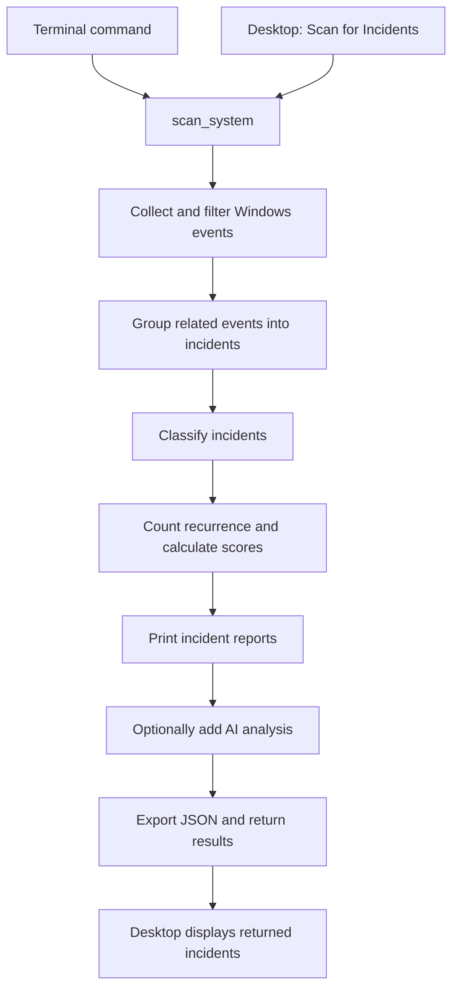

# LogOpen

LogOpen analyzes recent Windows Event Log warnings and errors, groups related
events into separate incidents, assigns deterministic classifications and scores,
and produces terminal and JSON reports.

## Finding your way around the code

The [code reference](docs/code_reference.md) maps the scan flow, data structures,
side effects, and every application function/class to its source file. Start with
`main.scan_system()` for the full workflow or `settings/credential_store.py` for
API key storage. Functions, methods, classes, and test helpers have docstrings you
can read by hovering over their names or using Go to Definition in your IDE.

## Requirements and usage

LogOpen runs on Windows. It uses `pywin32` for Windows Event Log access and secure
credential storage, `PyQt6` for the desktop UI and preferences, and `pydantic` for
structured analysis. Install `openai` to use optional AI analysis.

```powershell
python -m pip install pywin32 PyQt6 pydantic openai
python -m ui.main_window
# Or run a scan from the terminal:
python main.py
```

The application reads backward through each configured log to the 24-hour
boundary or end of the log, keeping warnings and errors during collection. A
configurable safety cap of 100,000 examined records per log prevents unbounded
scans. If the cap is reached, records are skipped, or a log cannot be fully read,
the scan is explicitly marked incomplete. Results are printed and exported to
`reports/incidents.json`; an export failure leaves the collected results visible.

`SCAN_WINDOW_HOURS` and `MAX_RECORDS_PER_LOG` in `config.py` control this scope.
The terminal exits with code `1` for an incomplete scan or failed export, `0` for
a complete scan with a successful export, and `130` for cancellation. Optional AI
failures do not change the scan's collection status.

Run the test suite with:

```powershell
python -m pip install pytest
python -m pytest -q
```

`python -m unittest` also runs the existing unittest cases. The full pytest suite
includes settings and AI integration coverage. Tests mock API calls, isolate
preferences in temporary files, and never use real credentials or network access.
`test_real_llm.py` is an explicit manual script; importing it does not call OpenAI.

## AI Settings

Open **Settings** in the desktop header. Enable or disable AI analysis, enter your
own password-masked OpenAI API key, and select **Save Key**. The input is cleared
after saving; stored keys are represented only by **API key configured**. Use
**Remove API Key** to delete the saved credential. Key changes take effect
immediately; **Save Settings** persists the enabled state, model, and analysis
limit. Close discards unsaved preferences. Settings are unavailable during a scan.

Preferences apply to the next scan, including terminal scans. Saved preferences
override `ENABLE_LLM_ANALYSIS`, `DEFAULT_ANALYSIS_MODEL`, and
`MAX_LLM_ANALYSES_PER_RUN` in `config.py`; those values supply initial defaults.
The current model default is `gpt-5.6-luna`. Enter any compatible model identifier;
there is no bundled model catalog. The scan limit is bounded to **1–20**. Invalid
stored models fall back to the default, malformed limits recover to a bounded
default, and unrecognized enabled values or unreadable settings disable AI.

Non-secret preferences use QSettings with organization/application **LogOpen**
(on Windows, `HKEY_CURRENT_USER\Software\LogOpen\LogOpen`). The key is stored
separately as a generic **LogOpen/OpenAI** credential in Windows Credential
Manager, using the existing pywin32 dependency. It persists for the current
Windows user on this machine. No new dependency or plaintext secret fallback is
added. LogOpen never writes a key to configuration, logs, incident dictionaries,
or exported reports. Unexpected AI exceptions are replaced with fixed messages.

Credential precedence is:

1. The securely stored user key.
2. `OPENAI_API_KEY` in the process environment, for development/testing.
3. No credentials: skip AI and continue deterministic analysis.

If secure storage is unavailable, saving/removing keys reports a safe error.
The environment fallback still works; without it, AI is skipped. Removing a saved
key does not clear the environment variable. Disable AI to skip all incident AI
requests, regardless of available credentials. An invalid stored key is reported
as an authentication failure; LogOpen does not silently switch to another key.
The resolved key is passed directly to `OpenAI(api_key=...)` inside the service
layer. Requests use `https://api.openai.com/v1`; `OPENAI_BASE_URL` is intentionally
not used for user credentials.

**Test Connection** saves preferences and checks the saved/environment credential
with [`models.retrieve`](https://developers.openai.com/api/reference/python/resources/models/methods/retrieve).
This reads metadata for the selected model without sending incident data or
generating an analysis. A successful test confirms authentication and model
metadata access; it does not prove inference quota or structured-output support.
Restricted keys need model-read permission for this check.

The test uses a QObject worker on a QThread, a 10-second request timeout, and no
automatic retries. Results are delivered by Qt signals to UI-thread slots. The
dialog prevents overlapping tests and waits for the worker to finish when closed,
including when its parent window closes. Error messages never include raw SDK
exceptions. Explicit testing works even when incident AI analysis is disabled.

Implementation files: `settings/app_settings.py` owns ordinary preferences,
`settings/credential_store.py` owns OS credentials and precedence,
`settings/ai_service.py` creates clients and checks connectivity, and
`ui/settings_dialog.py` owns the settings UI and connection worker. The existing
LLM eligibility, score ordering, and incident processing flow are preserved.

## Diagnostic command shells

Configure the shells used for new AI diagnostic recommendations in `config.py`:

```python
ALLOWED_DIAGNOSTIC_SHELLS = ("powershell", "cmd")
PREFERRED_DIAGNOSTIC_SHELL = "powershell"
```

Supported identifiers are `powershell`, `cmd`, and `bash`. The preferred shell
must be in the allowed list. Enable `bash` only when you have a suitable Bash
environment on Windows, such as WSL or Git Bash. Restart LogOpen after editing
the settings; existing analyses keep their original shell metadata.

Each diagnostic command is labeled PowerShell, Command Prompt, or Bash in the
AI analysis tab. Older commands without metadata show “Shell not specified”.
Steps without commands use `shell: null`. Commands can be selected and copied;
LogOpen does not execute them or install shells.

## Processing flow

```text
Windows Event Logs
    -> collect and normalize events
    -> filter recent warnings and errors
    -> bundle related events into separate incidents
    -> build and classify incident summaries
    -> annotate recurrence metadata
    -> refresh score, priority, reasons, and summary text
    -> terminal report
    -> optional AI analysis with explicit outcome status
    -> JSON export and return incidents with coverage/warnings
```

Incident bundling is based on provider, provider-scoped event ID, extracted
components, and the configured one-minute time window. An event can join a recent
incident even when unrelated events arrive in between. Cross-provider matches
require shared components, and different computers are kept separate. Recurrence analysis does not merge incidents;
it enriches each completed summary by comparing its classification and start time
with the other summaries in the current analysis set.

## Scoring

Scores are rule-based and capped at `100`. Every contribution is recorded in the
`incident_score_breakdown` object, and the final score is calculated as:

```text
min(sum(incident_score_breakdown.values()), 100)
```

| Dimension | Rule | Points |
| --- | --- | --- |
| Severity | Error / Warning | 40 / 20 |
| Event count | 3-4 / 5-9 / 10 or more events | 5 / 15 / 30 |
| Duration | Under 1 minute / 1-5 minutes / over 5-15 minutes / over 15 minutes | 0 / 5 / 10 / 15 |
| Recurrence | At least 3 matching classifications in 24 hours | 10 |
| Recurrence | At least 5 matching classifications in 7 days | 20 |
| Classification | Known classification impact | 0-20 |

Priority is derived from the capped score: `Critical` at 80 or above, `High` at
60-79, `Medium` at 40-59, and `Low` below 40.

## Scan report format

New scan exports are objects containing the incident array and scan metadata:

```json
{
  "incidents": [],
  "complete": true,
  "coverage": {
    "System": {
      "complete": true,
      "records_read": 0,
      "matched_events": 0,
      "oldest_time": null,
      "stop_reason": "end_of_log",
      "window_hours": 24
    }
  },
  "warnings": []
}
```

Read incident data from `report["incidents"]`. Older generated reports were a bare
array; consumers needing both formats can use
`report["incidents"] if isinstance(report, dict) else report`.
Coverage stop reasons include `time_boundary`, `end_of_log`, `record_limit`,
`read_error`, and `collection_error`. `complete` reflects collection and incident
processing; optional AI outcomes are recorded separately on each incident.
An export failure preserves the previous report on disk and returns the current
incidents with an export warning to the caller.

## Incident report fields

Each exported incident retains source and summary data, including:

- Classification, providers, event IDs, severity, timestamps, event count, and duration.
- `incident_score`, `incident_priority`, and human-readable `incident_score_reasons`.
- `incident_score_breakdown` with `severity`, `event_count`,
  `classification_impact`, `recurrence`, and `duration` values.
- `recurrence_count_24h`, `recurrence_count_7d`, and `is_recurring`.
- `summary_text`, a concise natural-language explanation of the incident and its score.

The current application input window is 24 hours. The recurrence module supports
seven-day comparisons when given seven days of summaries, but a production
seven-day recurrence signal requires collecting or retaining summaries beyond the
current 24-hour input window.

## Repository guide

| File or directory | Purpose |
| --- | --- |
| `main.py` | Application entry point and workflow orchestration. |
| `config.py` | Configures input logs, bundling thresholds, and provider labels. |
| `event_collection.py` | Reads and normalizes raw Windows Event Log records. |
| `event_filtering.py` | Filters events by severity level and time window. |
| `incident_detection.py` | Bundles events, builds summaries, and produces natural-language summary text. |
| `incident_classification.py` | Maps providers and known event patterns to incident classifications. |
| `incident_recurrence.py` | Adds classification-based recurrence metadata to completed summaries. |
| `incident_scoring.py` | Calculates score breakdowns, capped scores, priorities, and score reasons. |
| `terminal_reporting.py` | Renders incident summaries and source messages in the terminal. |
| `json_reporting.py` | Converts report values to JSON-safe data and exports report files. |
| `reports/incidents.json` | Generated output from the latest application run. |
| `models/scan_result.py` | List-compatible scan results with coverage and warnings. |
| `llm_analysis.py` | AI selection, evidence formatting, structured results, and safe outcome messages. |
| `ui/` | Desktop dashboard, incident details, settings, and styling. |
| `settings/` | Preferences, secure credentials, and API client setup. |
| `tests/helpers.py` | Shared factory for representative event dictionaries. |
| `tests/test_event_collection.py` | Tests Windows Event Log parsing and collection. |
| `tests/test_event_filtering.py` | Tests severity and time-window filtering. |
| `tests/test_incident_classification.py` | Tests provider, event, and incident classification. |
| `tests/test_incident_detection.py` | Tests similarity, bundling, summaries, and summary text. |
| `tests/test_incident_recurrence.py` | Tests recurrence counts, windows, and recurrence scoring. |
| `tests/test_incident_scoring.py` | Tests score rules, breakdowns, duration bands, capping, and priorities. |
| `tests/test_terminal_reporting.py` | Tests terminal output formatting. |
| `tests/test_main.py` | Tests the application workflow orchestration. |

## Code walkthrough

LogOpen is a Windows troubleshooting application with a terminal interface and a
PyQt6 desktop interface. Both use the same processing pipeline. Local rules group,
classify, and score incidents; optional AI analysis adds explanations and diagnostic
recommendations afterward.

Two terms describe the data flowing through the application:

- An **event** is one Windows Event Log entry.
- An **incident** is a group of related events, together with its classification,
  score, summary, and optional AI analysis.

Start with [main.py](main.py). It coordinates the workflow, while the individual
modules implement each processing step.



### 1. Collect and normalize events

[event_collection.py](event_collection.py) uses `pywin32` to read the Windows
**System** and **Application** logs configured in `config.LOG_TYPES`.
`get_recent_events()` reads backward from the newest records, using
a **100,000-record safety cap per log** in the standard workflow. It stops at the
24-hour boundary or end of the log when reached first, and records coverage
metadata with the returned events.

`parse_event()` converts each Windows-specific record into a regular Python
dictionary. The rest of the project uses this common format:

```python
{
    "log_type": "System",
    "computer_name": "Example-PC",
    "provider": "DCOM",
    "event_id": 10016,
    "time_generated": ...,  # A datetime value.
    "level": "Warning",
    "message": "...",
}
```

The collector translates Windows severity constants into readable labels and
formats the event message. If message formatting fails, it retains the structured
event with a fallback message. The Windows log handle is closed in a `finally`
block.

### 2. Filter and order events

[event_filtering.py](event_filtering.py) provides two small filters:

- `filter_events_by_time()` keeps events from the requested time window.
- `filter_events()` keeps events with one of the requested severity labels.

`main.py` uses these to retain **Warning** and **Error** entries from the
**last 24 hours**, combines events from both logs, and sorts them chronologically.

Severity is checked during collection, so informational events do not incur
message-formatting work or prevent finding errors beyond the old 500-record
limit. The safety cap still counts all examined records. Reaching that cap before
the time boundary or end of the log sets `complete` to false, records the reason,
and produces a warning in the terminal and desktop, including for empty results.

### 3. Group related events into incidents

[incident_detection.py](incident_detection.py) contains `bundle_incidents()`.
It walks through sorted events and considers existing incident groups with a
matching provider or extracted component on the same computer. Each candidate is
compared using its **last event**. A group is eligible if that event is no more
than one minute old and its similarity score is at least `3`. The strongest match
wins, followed by the most recent matching group, with a stable tie-breaker.

| Similarity signal | Points |
| --- | --- |
| Same provider | +2 |
| Same provider and event ID | +2 |
| Shared extracted component | +3 |
| Both events have extracted components, but none match | -3 |
| Within one minute | +1 |

The component extractor recognizes executable names such as `msmpeng.exe` and
uses a small alias mapping for Microsoft Defender. If either event has no
extracted components, the component contribution is zero. The total similarity
score is bounded below by zero.

For example, two events with the same provider and event ID, 20 seconds apart,
score `5` and are grouped together when there is no component mismatch.

The minute is a limit **between successive events in the same group**, not a limit on the whole
incident's duration. An incident can last longer if related events keep arriving.
Unrelated events in between no longer split a matching sequence. Grouping can
span the two input logs when there is evidence connecting the events. A shared
numeric event ID alone cannot join events from different providers.

### 4. Build and classify incident summaries

`build_incident()` converts an event group into a summary dictionary containing:

- Original source events.
- Provider and event-ID counts.
- Start time, end time, and duration.
- Highest severity.
- Event classifications and the overall incident classification.
- Score, priority, scoring reasons, score breakdown, and summary text.

[incident_classification.py](incident_classification.py) uses explicit rules based
on provider, event ID, and message text. Examples include:

| Event pattern | Classification |
| --- | --- |
| DNS Client event `1014` | DNS Resolution Timeout |
| DCOM event `10010` | DCOM Server Start Timeout |
| Service Control Manager event `7031` mentioning the Defender service | Defender Service Crash |

If several classifications appear in one incident, the most frequent becomes its
overall classification. Unrecognized events fall back to a readable provider name.
The summary's `log_types` contains every contributing log name, and `log_type`
provides a comma-separated display label. `computer_name` comes from the first
event; grouping keeps computers separate. Source events retain their own log
names, and those names are included individually in the AI context.

### 5. Count recurrence and refresh scores

[incident_recurrence.py](incident_recurrence.py) groups completed summaries by
classification. For each incident, it counts matching incidents in the preceding
24 hours and seven days, **including the incident itself**. It records
`recurrence_count_24h`, `recurrence_count_7d`, and `is_recurring` without merging
incidents.

An incident is recurring when at least three matching incidents occur within
24 hours or at least five occur within seven days.

[incident_scoring.py](incident_scoring.py) calculates the score using the rules
in the [Scoring](#scoring) section. Each contribution is recorded separately:

```text
score = min(severity + event_count + classification_impact + recurrence + duration, 100)
```

For example, six Error events classified as a Defender Service Crash, spanning
two minutes with no recurrence bonus, receive:

```text
40 severity + 15 event count + 20 classification + 5 duration = 80 -> Critical
```

Both recurrence bonuses can apply to the same incident. The priority is derived
from the capped score: Low below 40, Medium at 40-59, High at 60-79, and Critical
at 80 or above.

`build_incident()` calculates an initial score. After recurrence metadata is
available, `main.py` calls `refresh_incident_summary()` again so the score,
priority, reasons, and summary text reflect recurrence too.

The ordinary `summary_text` is assembled from templates and scoring reasons;
it works without AI.

Recurrence only sees the summaries passed into the current scan. The normal
workflow supplies at most 24 hours of events and does not load historical JSON
reports, so its seven-day field is not a complete seven-day history.

### 6. Add optional AI analysis

[llm_analysis.py](llm_analysis.py) selects incidents that meet at least one of
these conditions, provided AI is enabled and no analysis is already attached:

- High or Critical priority.
- Marked as recurring.
- At least five events.

Eligible incidents are sorted by score, highest first, then limited by the saved
preferences. The default limit is **three analyses per scan**.

`build_incident_context()` formats the summary, scores, recurrence metadata,
aggregate counts, and source evidence for the model. It includes up to **25
source events** and truncates individual messages after approximately **1,500
characters**.

`analyse_incident_with_llm_result()` calls `client.responses.parse()` and requests output
matching the Pydantic models in
[models/incident_analysis.py](models/incident_analysis.py):

```text
IncidentAnalysis
    explanation
    likely_causes
    recommended_actions
    remediation_notes
    diagnostic_steps[]
        description
        command
        shell
        risk_level
```

Each diagnostic step has a risk level of `safe`, `caution`, or `system_change`.
New generated commands must specify an allowed shell. Steps without commands
use a null shell. These checks validate the response structure and shell metadata;
they do not prove that a suggested command or diagnosis is correct.

`main.add_llm_analyses()` converts validated results into dictionaries and attaches
them under `llm_analysis`. Every incident receives `llm_analysis_status` and a safe
`llm_analysis_message`. Statuses are `disabled`, `not_selected`, `completed`, or
`failed`. Reasons distinguish eligibility and scan limits from missing credentials,
authentication, connectivity, rate limits, and invalid responses. The desktop's AI
tab displays the outcome, and the JSON report preserves it without raw SDK errors.

The compatibility helper `analyse_incident_with_llm()` still returns only an
`IncidentAnalysis` or `None` for callers such as the manual smoke test. Missing
credentials or AI failures leave deterministic incident results available.

Diagnostic commands are recommendations for review and copying. **LogOpen does
not execute them.**

### 7. Report, export, and return results

[terminal_reporting.py](terminal_reporting.py) prints incident summaries and source
messages. The workflow prints those reports before requesting AI analysis, then
prints available AI explanations after export.

[json_reporting.py](json_reporting.py) recursively converts dates and durations
into JSON-compatible values and writes `reports/incidents.json`. It writes a
temporary file beside the destination and replaces the previous report only after
the write succeeds, preserving the old report if serialization fails.

Export happens **after AI enrichment**, so the JSON includes generated analysis.
Each successful export replaces the previous report; this is not an accumulating
incident database. The relative output path is resolved from the working directory.

If export fails, the scan still returns its incidents together with an
`export_error` and warning. The desktop displays the results and the save failure.

`scan_system()` returns a `ScanResult`, a list of incident dictionaries with
`complete`, `coverage`, `warnings`, and `export_error` attributes. This also retains
coverage information when the incident list is empty.

### Understanding main.py

| Function | Responsibility |
| --- | --- |
| `_run_workflow()` | Runs the complete collection-to-reporting sequence. |
| `scan_system()` | Public entry point returning a list-compatible `ScanResult` with incidents, coverage, and warnings. |
| `add_llm_analyses()` | Loads AI preferences, selects incidents, and attaches AI results. |
| `main()` | Terminal wrapper that returns an exit code and handles selected failures. |
| `if __name__ == "__main__"` | Runs the terminal entry point when executing `python main.py`. |

The entry-point guard allows the desktop application to import `scan_system()`
without immediately starting a scan. `scan_system()` includes reporting and export
side effects as well as returning data, so desktop scans also run those steps.

### Desktop application

[ui/main_window.py](ui/main_window.py) builds the dashboard, scan button, metrics,
and incident table. Clicking **Scan for Incidents** starts a `ScanWorker` on a
`QThread`. The worker calls `scan_system()` while the main UI thread continues
handling window interaction. A Qt object signal delivers the `ScanResult` without
losing its metadata. The dashboard distinguishes complete scans, incomplete scans,
and completed scans with export warnings, while retaining available incidents.

The scan and settings buttons are disabled during a scan to prevent overlapping
operations. Closing the window during a scan waits for the worker to finish.

[ui/incident_detail.py](ui/incident_detail.py) displays the selected incident in
three tabs:

- **Overview:** metadata and score breakdown.
- **AI analysis:** explanations and diagnostic steps.
- **Source events:** original event records and messages.

Opening an incident uses existing results and does not trigger another scan or
AI request. [ui/style.qss](ui/style.qss) controls the visual styling.

### Configuration and settings responsibilities

[config.py](config.py) contains log names, grouping thresholds, provider labels,
AI defaults, context limits, allowed diagnostic shells, and the AI instruction
prompt. The prompt asks the model to distinguish evidence from hypotheses and
prefer diagnostic steps before system changes.

| File | Responsibility |
| --- | --- |
| [settings/app_settings.py](settings/app_settings.py) | Saves AI enabled state, model, and analysis limit using `QSettings`. |
| [settings/credential_store.py](settings/credential_store.py) | Stores the API key in Windows Credential Manager and resolves the environment fallback. |
| [settings/ai_service.py](settings/ai_service.py) | Creates the API client and implements connection testing. |
| [ui/settings_dialog.py](ui/settings_dialog.py) | Provides settings controls and the background connection-test worker. |

Saved AI preferences override the corresponding defaults in `config.py`.
**Test Connection** fetches model metadata; it does not analyze an incident.
See [AI Settings](#ai-settings) for credential precedence, persistence, and error
handling details.

### Tests and development entry points

The [tests](tests/) directory covers event collection and filtering, grouping,
classification, recurrence, scoring, JSON and terminal reporting, AI integration,
settings, and desktop behavior.

[tests/helpers.py](tests/helpers.py) supplies synthetic event dictionaries.
[tests/conftest.py](tests/conftest.py) isolates preferences, mocks credential
storage, and blocks real network connections for pytest runs.
[test_real_llm.py](test_real_llm.py) is a separate manual API smoke test that reads
the first incident from the exported report. It accepts both the current report
object and older reports containing only an incident array. Unit tests use
synthetic incident fixtures rather than depending on the latest generated report.

[docs/llm_command_eval_cases.md](docs/llm_command_eval_cases.md) records observed
failures in generated diagnostic commands and their evaluation status. Prompt
changes alone do not establish that those cases have been resolved.

Useful commands from the repository root:

```powershell
python -m ui.main_window   # Desktop application.
python main.py            # Terminal scan.
python -m pytest -q        # Test suite.
```
