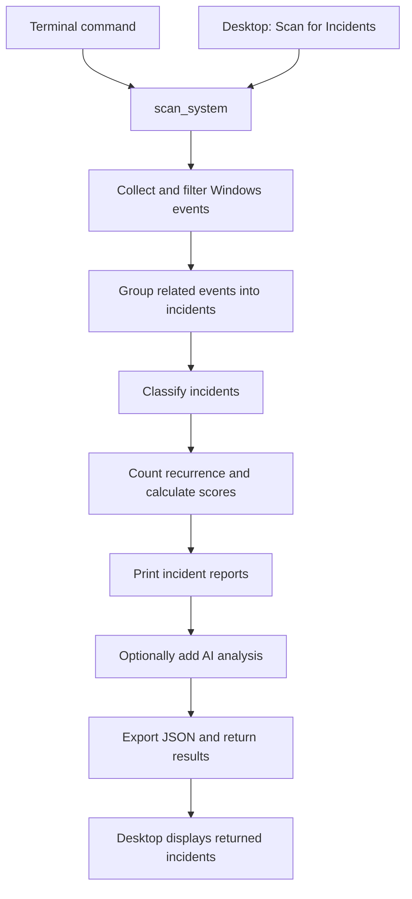

# LogOpen

Licensed under **GNU GPLv3 (GPL-3.0-only)**. See [LICENSE](LICENSE) and
[third-party notices](THIRD_PARTY_NOTICES.md).

Before announcing a public build, complete the [release checks](docs/release-checklist.md).
The [privacy guide](docs/privacy.md) explains local storage and AI sharing.
Manual AI requests now show a masked preview before sending. Automatic sharing
requires a separate opt-in under **Help → Privacy and local data**, also accessible
from **Settings → App**. This screen provides confirmed history/key removal.
Use **Help → Report a problem** to prepare a report locally for review and sharing.
Model choices distinguish documented structured-output support from unverified
compatibility; neither account model listings nor connection tests prove live analysis works.

LogOpen analyzes Windows Event Log warnings, errors, audit failures, and events
matched by detection rules. It groups related
events into separate incidents, assigns deterministic classifications and scores,
and produces terminal and JSON reports.

## Your first desktop scan

1. Choose a symptom under **What would you like to check?**, or keep **General check**,
   then choose **Scan my PC**. The defaults check recent Windows activity; an API key
   is not required to scan.
2. Use **Start here → Understand this problem** for the highest-priority unreviewed
   problem in the current filtered view. You can also select
   a row and choose **Understand problem**, or double-click the row.
3. Read **Summary** for what happened and **Checks you can try · no AI needed**.
   Built-in checks explain what to inspect, where to find it, and how to assess the
   result. They work offline without an API key. **Next steps (AI)**
   offers optional AI explanations; **Set up AI** opens the key settings.
   **Windows logs** contains the original evidence. **Technical details and
   scoring** expands the detailed metadata.

The scan workspace brings symptom selection, scan options, and the main action
together. After a scan, it becomes more compact to make room for the results.
On taller windows, clickable summary cards show problem, priority, and evidence
counts. The welcome illustration is decorative and does not represent scan results.

The three-step guide shows your place in the flow on roomy windows. **Quick guide** reopens the
instructions at any time. Icons accompany text labels, and priority always has
a written label. These results describe the Windows logs checked; they are not
a complete PC health assessment.

## Desktop features

- **File → Restart as administrator…** (also **Settings → App → Windows
  permissions**) requests an elevated LogOpen instance through the normal Windows
  UAC prompt. The title bar and App settings show the current process's actual
  access level. Ordinary launches remain unelevated; no permissions, group
  membership, or UAC settings are changed. Restart saves the open incident note,
  waits for background work, and stops monitoring. Run a new scan afterward.
  Cancelling UAC or a launch failure keeps the current window and results open.
  Settings initiated restarts save edited preferences first. Administrator access
  can unlock restricted logs but cannot guarantee access against organization
  policy. Entering a different administrator account uses that account's settings,
  credentials, and local history. Access-denied coverage now points to this action.
- **View → Compare scans…** lets you choose an earlier baseline from the latest
  100 saved scans. It shows new issue families, families seen in both scans, and
  problems no longer observed. Missing problems are reported only when both scans
  are complete and have matching scope. Overlapping scan windows can contain the
  same evidence; “seen in both” does not necessarily mean another failure.
- **Summary → Incident history** combines observations in the latest 500 saved
  scans with the latest 500 local notes, review decisions, temporary hiding,
  Undo actions, checklist changes, and **Check again** outcomes for that issue.
  Observations are scan sightings, not a count of separate failures. Action
  history starts with this feature; older saved observations remain available.
- **Summary → Explain simply** provides an offline explanation of what happened,
  possible symptoms, and the best first check. It makes no AI request and does
  not assume a historical problem is still happening.
- **Summary → Troubleshooting checklist** lets you mark built-in checks completed,
  record results, and add your own checks (including advice from AI or support).
  Choose **Save progress** to resume across future scans. Up to 50 checks per issue
  are stored locally; checks are never executed automatically or sent to AI.
- **File → Prepare support report for selected/filtered incidents…** creates an
  editable text preview with evidence, coverage, and saved troubleshooting results.
  Common usernames/emails, computer names, and paths are masked by default; you
  can add exact text to remove and optionally include your local note. Masking is
  best effort, so review messages and results before saving. Rebuilding the preview
  replaces manual edits; **Save reviewed report** writes the exact preview locally.
  Nothing is sent or uploaded, and stored source evidence is unchanged.
- **Monitor → Notification preferences…** saves priority choices, desktop-alert
  preferences, quiet hours in local time, and an optional 0–600 second grouping
  window. Zero gives one summary per scan. Quiet hours can cross midnight; equal
  start/end times silence alerts all day. These choices govern alert sounds and
  desktop notifications, while scans, refreshes, and in-app counts continue.
  Suppressed alerts are not replayed later. Delayed alerts recheck review decisions;
  stopping monitoring or changing notification preferences clears pending alerts.
- **Health** in the bottom bar (also **Monitor → Monitoring health…**) shows the
  last complete scan, latest result, next scheduled scan, errors, and channel
  coverage gaps. It distinguishes waiting, scanning, failed scans, and stopped
  monitoring. Times describe the current monitoring session; a busy app or a
  sleeping PC can delay the next scan.
- **View → Group repeated problems** collapses matching issue families into a
  representative row, ranked by priority and score, with an occurrence count and
  relative last-seen time. Click the problem name to expand/collapse its rows, or
  use **Expand / collapse selected occurrences**. Filtered exports retain every
  matched occurrence; selecting a collapsed group exports or reviews all its
  matched members. Grouping changes presentation, not scoring or raw evidence.
- **What was checked?** beside the scan status (**Coverage** on narrow windows)
  opens the report's exact source logs, time range, limits, read/retained counts,
  collection stop reasons, and suggested next actions for missing coverage.
  Historical reports without coverage metadata display **Partial / unknown**.
- **Check again** on an incident rescans its source logs using the report's known
  time range, limit, and detection rules, without automatic AI. The saved default
  scan scope is retained. Results distinguish new matching evidence from activity
  already seen. A missing issue is never labeled fixed; missing coverage, changed
  rules, or gaps since an old scan prevent an absence conclusion.
- **Summary → Your notes and temporary hiding** saves a plain-text note for an
  issue family across scans and offers **Hide for 24 hours**. Notes are stored
  locally and omitted from AI requests; explicit JSON exports include notes
  attached to exported incidents. Temporarily hidden issues skip automatic AI
  and alerts, and return to their previous review state after expiry. Use
  **Hidden temporarily** to find them. **Undo** in the bottom bar or **Ctrl+Z**
  restores the last review/hiding decision without undoing independently saved notes.
- **View → Show selection preview on wide windows** displays the selected
  incident and local checks beside the table at widths of at least 1,400 pixels.
  **Open full details** opens the complete evidence. The preview preference saves.
- Summary cards are clickable and keyboard accessible: **Problems found** clears
  the priority filter, **Review first** selects High and Critical, and **Log
  entries** opens the filtered timeline. Active filter chips on taller windows
  can be removed individually. Relative scan times retain the exact timestamp
  in a tooltip; reports with no scan timestamp say it is unavailable.
- **View → Reading and accessibility…** (**Ctrl+Shift+A**, also **Settings → App →
  Reading options…**) offers saved dark/light themes, text sizes up to 200%, and
  reduced motion. **Ctrl++ / Ctrl+-** changes text size; **Ctrl+0** restores the
  comfortable size. **Ctrl+F** focuses problem search. Enlarged forms scroll,
  keyboard focus stays visible, and priorities have written labels alongside
  colours and icons. Animations start disabled unless previously enabled.
  See the [accessibility guide](docs/accessibility.md) for controls and checks.
- **What would you like to check?** offers General check, Internet problems,
  App crashes, Slow startup, Update failures, Security concerns, and advanced
  performance/custom choices. Selecting one sets the source logs for the next
  scan and saves the choice; it does not start a scan. Time range, record limits,
  custom detection rules, and AI preferences are retained. **Scan options** shows
  the exact logs. Disabled or inaccessible logs still produce coverage warnings.
- **Start here** recommends an active problem by priority, then score, within
  the current filters. It skips reviewed and hidden issues, updates after review
  decisions, and opens the correct incident after sorting. The card also works
  when reopening reports or history.
- **Summary → Checks you can try** includes local guidance for network, app,
  service, Defender, update, startup, sign-in, and DCOM issues. Unknown/custom
  classifications receive general evidence-review steps. These checks never
  execute commands or contact an AI service. Network, update, and Defender checks
  follow Microsoft's [Wi-Fi guidance](https://support.microsoft.com/en-au/windows/experience/connectivity-networking/fix-wi-fi-connection-issues-in-windows),
  [update guidance](https://support.microsoft.com/en-us/windows/deployment/updates-lifecycle/troubleshoot-problems-updating-windows),
  and [Protection history guidance](https://support.microsoft.com/en-us/windows/security/windows-security/protection-history-in-the-windows-security-app).
- **Settings → App** includes **Create desktop shortcut**, a sound toggle, and
  **Test sound**. The shortcut uses the LogOpen icon and your Windows desktop
  location, including OneDrive desktops. New installations select the desktop
  shortcut by default; it can be deselected during setup.
- Subtle sound cues mark a scan starting, scan/AI completion, a verified update
  download, and errors. **View → Sound effects** offers quick muting. The preference
  saves immediately. Opening saved reports or history does not play scan sounds.
  Playback is asynchronous and has no effect on scanning if audio is unavailable.
  The original WAV cues are bundled; regenerate them with
  `python scripts/generate_sounds.py`. Automated/offscreen runs remain silent;
  `LOGOPEN_DISABLE_SOUNDS=1` also disables playback.
- **Updates** in the header (also **Help → Check for updates…**) checks the latest
  stable release in [Hiroshinoharu/LogOpen](https://github.com/Hiroshinoharu/LogOpen/releases).
  **Download & install…** downloads the Windows installer to the app's update
  folder, checks its size and SHA256, stops monitoring, waits for background work,
  and closes LogOpen after opening setup. Setup remains interactive and offers
  to launch LogOpen when finished. The installer is checked again before launch;
  if it is missing, changed, or cannot start, LogOpen stays open with an error.
  Cancelling or closing the download dialog prevents automatic installation.
  **Download update** still lets you save an installer or portable ZIP to a chosen
  location. A downloaded installer offers **Install downloaded update…**; portable
  ZIPs are extracted manually into a new folder. **Open download folder** locates
  either package. Source runs are clearly labeled: setup updates the installed
  app, not your source checkout.
  Checks run only when requested; no GitHub token, API key, or incident data is sent.
- **Settings → Terminal** chooses PowerShell, Command Prompt, or Bash via WSL,
  in a standard window or Windows Terminal. **Save Settings** applies the command
  format to new AI suggestions. **Open selected terminal** tries the choice before
  saving. **View → Terminal settings…** opens this page directly.
  **Open terminal** beside a saved command opens that command's recorded shell,
  using the selected window host. It opens an empty terminal; it never passes the
  suggested command to the process. Bash requires WSL with Bash installed;
  Windows Terminal must be installed to use that host.
- **Scan options** chooses a General, Security, Networking, Performance and updates,
  or Custom profile, with editable channels, lookback hours, and record limit.
  **Advanced scan options** contains channel and record
  limits. **Choose Windows logs…** searches registered Windows channels and
  checks read access. **Detection rules…** edits validated custom JSON rules
  and shows built-in rules.
  Desktop choices persist across launches. The CLI keeps using `config.py` defaults.
- **Cancel scan** stops collection, grouping, or further AI requests cooperatively.
  An active Windows read or API request finishes first. Available partial results
  remain visible; cancellation preserves the previously saved report and history.
  The final short save phase cannot be cancelled.
- **Scan history** in the main window or **File → Scan history…** opens previous scans. Comparisons identify new,
  persistent, and no-longer-observed issue families. Absence is reported only for
  complete scans with the same logs, lookback, record limit, and detection rules; it does not prove
  that an issue has been fixed.
- **Search**, priority, and review filters narrow the incident table. **More
  filters…** adds provider, classification, and inclusive start-date constraints.
  **View → Clear filters** resets them. Ignored issues are hidden by default.
- **File → Open report…** loads both current JSON envelopes and older incident
  arrays without rescanning or contacting OpenAI.
- **File → Export selected/filtered incidents…** writes JSON, CSV, or a readable
  Markdown report to a chosen location. Selection follows sorting and filtering.
- **Summary → Mark reviewed / Hide problem / Show again** remembers review decisions for
  the same machine/classification/provider/event-ID issue family across scans.
  Ignored issues remain in evidence/history and skip automatic AI requests.
- **Next steps (AI) → Explain with AI / retry** requests one selected incident using the
  saved model and key, even if automatic selection skipped it. AI must be enabled;
  normal API charges apply. A failed retry keeps any previous successful analysis.
  Results opened from local history are updated there; imported files are only
  changed in memory until explicitly exported.
- Page transitions fade briefly and the status badge pulses during background
  work. **View → Enable animations** can disable motion and remembers the choice.
- **View → Timeline of filtered incidents…** places evidence from different logs
  on one chronological table. Each incident also has a **Timeline** tab, including
  raw structured payload, record identity, correlation IDs, and matching rules.
- **Live monitoring** in the header (**Ctrl+M**), **Watch for new incidents** in the bottom bar (also **Monitor → Start live
  monitoring…**) runs local scans every 30–3,600 seconds after the previous scan
  finishes; the default is 60 seconds. It uses the current scope and saves history.
  The incident list refreshes automatically, retaining filters, sorting, surviving
  selections, and scroll position. An open detail page stays intact; returning to
  results shows the latest scan. The first scan is a silent baseline; later new
  active incidents at any priority show an in-app count. Eligible alerts play the
  enabled sound and optionally trigger desktop notifications, following your
  priority, quiet-hour and grouping preferences. Repeated evidence and
  reviewed/hidden issues do not trigger repeat alerts. Click the notice or desktop
  notification to open the latest results; clicks during a scan wait for cleanup.
  By default it collects every event level in the selected logs, within the
  current time window and record cap. **Monitor → View collected events…** shows
  routine activity alongside problem evidence. Routine events are not scored as
  problems or sent for automatic AI analysis. Uncheck **Collect all event levels**
  before starting to collect only warnings and detection-rule matches.
  Monitoring always skips automatic AI and stops when the app closes. Use
  **View latest monitoring scan** to review results, or **Stop watching** to stop.
  A prominent status panel stays visible above results and problem details while
  monitoring runs, showing scanning, waiting, failure, and quiet-hour states.
  The tray icon remains present during monitoring, including when alerts are off.
  **Test notification** requests one sample banner even during LogOpen quiet hours;
  it does not change your saved preferences. **Notification options** shows why
  alerts are paused and links to Windows notification settings. Windows controls
  whether a requested banner appears; a successful request is not delivery proof.
  Resizing or maximizing prioritizes table space: summary cards and the Start here
  card collapse on shorter windows, and multiple warnings are summarized with the
  full text available under **Coverage**. Large text on very short windows also
  moves symptom selection into **Scan options**. Page fades end on resize and no
  page rendering effect remains active after a transition.

See [event sources, detection rules, and monitoring](docs/event_sources.md) for
supported channels, custom-rule examples, permissions, and polling limitations.

Click a column header to sort; click again to reverse. Numbers sort numerically,
timestamps chronologically, and priority/severity by rank. The chosen order
survives refreshes. Short windows collapse summary cards to leave room for rows.
Table windows open broadly within the available screen, with a maximize button.
Columns fit their contents and remain manually resizable. Wide tables scroll
horizontally instead of squeezing long channel names and descriptions; hover a
cell to read its full text.

History lives in `%LOCALAPPDATA%\LogOpen\history.sqlite3` and contains incident
evidence, including source messages and saved AI explanations. It never contains
API keys. `LOGOPEN_DATA_DIR` overrides the history directory for isolated runs.
Retained observations support seven-day recurrence, with overlapping source
events deduplicated so repeatedly scanning the same window does not inflate counts.
Unscanned periods remain unknown. Monitoring is periodic and only runs while the app is open.

For the executable, ZIP bundle, and installer, see
[Windows distribution](docs/distribution.md).

## Automatic versions and releases

GitHub Actions tests and packages branch pushes and pull requests. Successful
pushes to the default branch (`master`) automatically publish the next release:
ordinary/fix commits bump the patch, `feat:` bumps the minor, and a breaking-change
marker bumps the major. Multiple commits in one push produce one version.

Download installers from [GitHub Releases](https://github.com/Hiroshinoharu/LogOpen/releases).
See [CI/CD and version rules](docs/releases.md) for setup, examples, and recovery.

## Finding your way around the code

The [code reference](docs/code_reference.md) maps the scan flow, data structures,
side effects, and every application function/class to its source file. Start with
`main.scan_system()` for the full workflow or `settings/credential_store.py` for
API key storage. Functions, methods, classes, and test helpers have docstrings you
can read by hovering over their names or using Go to Definition in your IDE.

## Requirements and usage

LogOpen runs on Windows. It uses `pywin32` for Windows Event Log access and secure
credential storage, `PyQt6` for the desktop UI and preferences, and `pydantic` for
structured analysis. Install `openai` to use optional AI analysis.

```powershell
python -m pip install -r requirements.txt
python -m ui.main_window
# Or run a scan from the terminal:
python main.py
```

The application uses Windows' modern `EvtQuery` API for classic and operational
channels. Windows filters records to the selected time window (24 hours by default),
then LogOpen reads backward and keeps relevant severity/rule matches. A
configurable safety cap of 100,000 examined records per log prevents unbounded
scans. Reaching the cap, skipping invalid records, read failures, or disabled logging
mark the scan incomplete. Results are printed and exported to
`reports/incidents.json`; an export failure leaves the collected results visible.

`SCAN_WINDOW_HOURS` and `MAX_RECORDS_PER_LOG` in `config.py` provide the default scope.
The terminal exits with code `1` for an incomplete scan or failed export, `0` for
a complete scan with a successful export, and `130` for cancellation. Optional AI
failures do not change the scan's collection status.

Run the test suite with:

```powershell
python -m pip install -r requirements-dev.txt
python -m pytest -q
```

`python -m unittest` also runs the existing unittest cases. The full pytest suite
includes settings and AI integration coverage. Tests mock API calls, isolate
preferences in temporary files, and never use real credentials or network access.
`test_real_llm.py` is an explicit manual script; importing it does not call OpenAI.

## AI Settings

The built-in analysis prompt is versioned in `config.ANALYSIS_PROMPT_VERSION`.
New successful analyses record `llm_prompt_version` in their incident metadata.
The prompt separates observations, possible causes, and checks; asks for a
useful next observation; and keeps historical events distinct from current
status. Existing command-grounding and least-privilege rules are retained.
See [prompt evaluation](docs/prompt_evaluation.md) for regression cases and the
limits of offline tests. Existing saved AI explanations are not rewritten.

Open **Settings** in the desktop header. Enable or disable AI analysis, enter your
own password-masked OpenAI API key, and select **Save Key**. The input is cleared
after saving; stored keys are represented only by **API key configured**. Use
**Remove API Key** to delete the saved credential. Key changes take effect
on the next AI request, without restarting; **Save Settings** saves any newly
typed key along with the enabled state, model, and analysis limit. After saving
a key, use **Test Connection**, retry AI on an existing incident, or run a new
scan. Existing results are not automatically reanalyzed. Close discards unsaved
preferences and typed keys. Settings are unavailable during a scan.

**Restart App** saves settings and any typed key, then reopens LogOpen. Restarting
stops live monitoring and waits for background work to finish. Saved scans remain
available in History. If the new process cannot be started, the current window
stays open and shows an error.

Preferences apply to the next scan, including terminal scans. Saved preferences
override `ENABLE_LLM_ANALYSIS`, `DEFAULT_ANALYSIS_MODEL`, and
`MAX_LLM_ANALYSES_PER_RUN` in `config.py`; those values supply initial defaults.
The current model default is `gpt-5.6-luna`. **Settings → AI help → Choose an AI
model** is an editable dropdown with the full bundled catalog and your saved model.
Settings automatically retrieves candidate text models when a key is configured;
**Load available models** manually refreshes them using
OpenAI's [models list endpoint](https://developers.openai.com/api/reference/python/resources/models/methods/list).
It runs in the background, keeps the current selection, and sends no incident
data. Known specialist/audio/image models are filtered out; the endpoint does
not establish Responses or structured-output support. You can enter any compatible
model ID, including custom models. Without a key, the bundled catalog stays available offline.
Select **Save Settings** to apply the choice. The scan limit is bounded to **1–20**. Invalid
stored models fall back to the default, malformed limits recover to a bounded
default, and unrecognized enabled values or unreadable settings disable AI.

Every model choice gets a price flag: **€ Budget**, **€€ Balanced**,
**€€€ Higher cost**, or **? Price unknown**. Flags are also shown beside the
next manual AI request. These are LogOpen cost bands for the example below:
up to €0.01, up to €0.05, and above €0.05 per analysis, respectively.
The price card shows estimated EUR input/output and available cached-input rates and the same illustrative
usage for each model: 10,000 input and 2,000 billed output tokens. Changing the
analysis count updates the example scan cost. This is an illustration, not a
prediction, bill, or spending cap; reasoning, actual usage, caching, processing
tier, and account settings can change charges. The AI detail page also shows
the model and cost category for the next request.

Published USD rates are retained internally and converted only for display,
using the bundled [ECB reference rate](https://www.ecb.europa.eu/stats/policy_and_exchange_rates/euro_reference_exchange_rates/html/index.en.html)
of **€1 = 1.1179 USD on 3 November 2026**. Euro amounts are estimates, exclude
taxes and conversion fees, and do not use live exchange rates. The rate and
date appear in Settings and model tooltips. Totals are converted before rounding.

Rates in `settings/model_catalog.py` were checked against the official OpenAI
[pricing page](https://developers.openai.com/api/docs/pricing) and model pages on
**3 November 2026**. The bundled table covers 42 exact text-model IDs across
GPT-6, GPT-5, GPT-4, GPT-3.5 and o-series models, including published specialist
models. This pricing catalog does not imply account access or compatibility.
All 42 bundled model IDs appear immediately, including without a key or internet.
Opening Settings with a configured key automatically loads the account's text
models in the background; saving or detecting a key also triggers discovery.
The current selection is preserved, including changes made while loading.
Failed requests keep the existing list, and **Load available models** retries
or refreshes it. Loaded and manually entered IDs use the same pricing lookup.
Other IDs, unverified dated snapshots, and fine-tuned
models say **Price unknown**; prices are never inferred from names. **View
OpenAI pricing** opens the selected model's official rate source. Loading model metadata does
not refresh prices. Choosing a model leaves the saved default unchanged until Save.

Non-secret preferences use QSettings with organization/application **LogOpen**
(on Windows, `HKEY_CURRENT_USER\Software\LogOpen\LogOpen`). The key is stored
separately as a generic **LogOpen/OpenAI** credential in Windows Credential
Manager, using the existing pywin32 dependency. It persists for the current
Windows user on this machine. No new dependency or plaintext secret fallback is
added. LogOpen never writes a key to configuration, logs, incident dictionaries,
or exported reports. Unexpected AI exceptions are replaced with fixed messages.

Credential precedence is:

1. The securely stored user key.
2. `OPENAI_API_KEY` in the process environment.
3. `OPENAI_API_KEY` in Windows user environment settings (`HKCU\Environment`).
4. `OPENAI_API_KEY` in Windows system environment settings.
5. No credentials: skip AI and continue deterministic analysis.

Settings checks these locations on opening. **Check this PC for a key** checks
again and shows its source without displaying or copying the secret. Only the
named environment value is read. Persisted Windows settings are checked afresh
for each AI request, so a key added there after launch can be used without a
restart. An existing process key still takes precedence over persisted values.

If secure storage is unavailable, saving/removing keys reports a safe error.
The environment fallback still works; without it, AI is skipped. Removing a saved
key does not clear the environment variable. Disable AI to skip all incident AI
requests, regardless of available credentials. An invalid stored key is reported
as an authentication failure; LogOpen does not silently switch to another key.
The resolved key is passed directly to `OpenAI(api_key=...)` inside the service
layer. Requests use `https://api.openai.com/v1`; `OPENAI_BASE_URL` is intentionally
not used for user credentials.

**Test Connection** saves preferences and checks the saved/environment credential
with [`models.retrieve`](https://developers.openai.com/api/reference/python/resources/models/methods/retrieve).
This reads metadata for the selected model without sending incident data or
generating an analysis. A successful test confirms authentication and model
metadata access; it does not prove inference quota or structured-output support.
Restricted keys need model-read permission for this check.

Connection testing and model loading use QObject workers on a QThread, a 10-second request timeout, and no
automatic retries. Results are delivered by Qt signals to UI-thread slots. The
dialog prevents overlapping checks and waits for the worker to finish when closed,
including when its parent window closes. Error messages never include raw SDK
exceptions. Explicit testing works even when incident AI analysis is disabled.

Implementation files: `settings/app_settings.py` owns ordinary preferences,
`settings/credential_store.py` owns OS credentials and precedence,
`settings/ai_service.py` creates clients and checks connectivity, and
`ui/settings_dialog.py` owns the settings UI and connection worker. The existing
LLM eligibility, score ordering, and incident processing flow are preserved.

## Diagnostic command shells

Choose **Settings → Terminal** to set the command format for new AI diagnostic
recommendations. Saving applies to the next AI request without restarting. An
explicit saved choice restricts new command suggestions to that format. Existing
analyses retain their original shell labels, and their **Open terminal** buttons
match those labels.

When no terminal preference has been saved, `config.py` supplies the defaults:

```python
ALLOWED_DIAGNOSTIC_SHELLS = ("powershell", "cmd")
PREFERRED_DIAGNOSTIC_SHELL = "powershell"
```

Supported identifiers are `powershell`, `cmd`, and `bash`. The preferred shell
must be in the allowed list. Enable `bash` only when you have a suitable Bash
environment on Windows, such as WSL or Git Bash. The app's Bash launcher uses WSL.
Restart LogOpen after editing `config.py`; use the UI for changes during a session.

Each diagnostic command is labeled PowerShell, Command Prompt, or Bash in the
Next steps (AI) tab. Older commands without metadata show “Shell not specified”.
Steps without commands use `shell: null`. Commands can be selected and copied;
LogOpen does not execute them or install shells.

## Processing flow

```text
Windows Event Logs
    -> collect and normalize events
    -> filter recent warnings and errors
    -> bundle related events into separate incidents
    -> build and classify incident summaries
    -> annotate recurrence metadata
    -> refresh score, priority, reasons, and summary text
    -> terminal report
    -> optional AI analysis with explicit outcome status
    -> JSON export and return incidents with coverage/warnings
```

Incident bundling is based on provider, provider-scoped event ID, extracted
components, and the configured one-minute time window. An event can join a recent
incident even when unrelated events arrive in between. Cross-provider matches
require shared components, and different computers are kept separate. Recurrence analysis does not merge incidents;
it enriches each completed summary by comparing its classification and start time
with the other summaries in the current analysis set.

## Scoring

Scores are rule-based and capped at `100`. Every contribution is recorded in the
`incident_score_breakdown` object, and the final score is calculated as:

```text
min(sum(incident_score_breakdown.values()), 100)
```

| Dimension | Rule | Points |
| --- | --- | --- |
| Severity | Error / Warning | 40 / 20 |
| Event count | 3-4 / 5-9 / 10 or more events | 5 / 15 / 30 |
| Duration | Under 1 minute / 1-5 minutes / over 5-15 minutes / over 15 minutes | 0 / 5 / 10 / 15 |
| Recurrence | At least 3 matching classifications in 24 hours | 10 |
| Recurrence | At least 5 matching classifications in 7 days | 20 |
| Classification | Known classification impact | 0-20 |

Priority is derived from the capped score: `Critical` at 80 or above, `High` at
60-79, `Medium` at 40-59, and `Low` below 40.

## Scan report format

New scan exports are objects containing the incident array and scan metadata:

```json
{
  "incidents": [],
  "complete": true,
  "coverage": {
    "System": {
      "complete": true,
      "records_read": 0,
      "matched_events": 0,
      "oldest_time": null,
      "stop_reason": "end_of_log",
      "window_hours": 24
    }
  },
  "warnings": []
}
```

Read incident data from `report["incidents"]`. Older generated reports were a bare
array; consumers needing both formats can use
`report["incidents"] if isinstance(report, dict) else report`.
Coverage stop reasons include `time_boundary`, `end_of_log`, `record_limit`,
`read_error`, and `collection_error`. `complete` reflects collection and incident
processing; optional AI outcomes are recorded separately on each incident.
An export failure preserves the previous report on disk and returns the current
incidents with an export warning to the caller.

## Incident report fields

Each exported incident retains source and summary data, including:

- Classification, providers, event IDs, severity, timestamps, event count, and duration.
- `incident_score`, `incident_priority`, and human-readable `incident_score_reasons`.
- `incident_score_breakdown` with `severity`, `event_count`,
  `classification_impact`, `recurrence`, and `duration` values.
- `recurrence_count_24h`, `recurrence_count_7d`, and `is_recurring`.
- `summary_text`, a concise natural-language explanation of the incident and its score.

The default input window is 24 hours and can be changed in the desktop. Historical
recurrence combines saved and current observations on the same machine and with
the same classification. Shared source events merge overlapping observations so
repeated scans count an occurrence once. Counts cover observed incidents only.

## Repository guide

| File or directory | Purpose |
| --- | --- |
| `main.py` | Application entry point and workflow orchestration. |
| `config.py` | Configures input logs, bundling thresholds, and provider labels. |
| `event_collection.py` | Reads and normalizes raw Windows Event Log records. |
| `event_filtering.py` | Filters events by severity level and time window. |
| `incident_detection.py` | Bundles events, builds summaries, and produces natural-language summary text. |
| `incident_classification.py` | Maps providers and known event patterns to incident classifications. |
| `incident_recurrence.py` | Adds classification-based recurrence metadata to completed summaries. |
| `incident_scoring.py` | Calculates score breakdowns, capped scores, priorities, and score reasons. |
| `terminal_reporting.py` | Renders incident summaries and source messages in the terminal. |
| `json_reporting.py` | Converts report values to JSON-safe data and exports report files. |
| `reports/incidents.json` | Generated output from the latest application run. |
| `models/scan_result.py` | List-compatible scan results with coverage and warnings. |
| `llm_analysis.py` | AI selection, evidence formatting, structured results, and safe outcome messages. |
| `ui/` | Desktop dashboard, incident details, settings, and styling. |
| `settings/` | Preferences, secure credentials, and API client setup. |
| `tests/helpers.py` | Shared factory for representative event dictionaries. |
| `tests/test_event_collection.py` | Tests Windows Event Log parsing and collection. |
| `tests/test_event_filtering.py` | Tests severity and time-window filtering. |
| `tests/test_incident_classification.py` | Tests provider, event, and incident classification. |
| `tests/test_incident_detection.py` | Tests similarity, bundling, summaries, and summary text. |
| `tests/test_incident_recurrence.py` | Tests recurrence counts, windows, and recurrence scoring. |
| `tests/test_incident_scoring.py` | Tests score rules, breakdowns, duration bands, capping, and priorities. |
| `tests/test_terminal_reporting.py` | Tests terminal output formatting. |
| `tests/test_main.py` | Tests the application workflow orchestration. |

## Code walkthrough

LogOpen is a Windows troubleshooting application with a terminal interface and a
PyQt6 desktop interface. Both use the same processing pipeline. Local rules group,
classify, and score incidents; optional AI analysis adds explanations and diagnostic
recommendations afterward.

Two terms describe the data flowing through the application:

- An **event** is one Windows Event Log entry.
- An **incident** is a group of related events, together with its classification,
  score, summary, and optional AI analysis.

Start with [main.py](main.py). It coordinates the workflow, while the individual
modules implement each processing step.



### 1. Collect and normalize events

[event_collection.py](event_collection.py) uses `pywin32` to read the Windows
**System** and **Application** logs configured in `config.LOG_TYPES`.
`get_recent_events()` reads backward from the newest records, using
a **100,000-record safety cap per log** in the standard workflow. It stops at the
24-hour boundary or end of the log when reached first, and records coverage
metadata with the returned events.

`parse_event()` converts each Windows-specific record into a regular Python
dictionary. The rest of the project uses this common format:

```python
{
    "log_type": "System",
    "computer_name": "Example-PC",
    "provider": "DCOM",
    "event_id": 10016,
    "time_generated": ...,  # A datetime value.
    "level": "Warning",
    "message": "...",
}
```

The collector translates Windows severity constants into readable labels and
formats the event message. If message formatting fails, it retains the structured
event with a fallback message. The Windows log handle is closed in a `finally`
block.

### 2. Filter and order events

[event_filtering.py](event_filtering.py) provides two small filters:

- `filter_events_by_time()` keeps events from the requested time window.
- `filter_events()` keeps events with one of the requested severity labels.

`main.py` uses these to retain **Warning** and **Error** entries from the
**last 24 hours**, combines events from both logs, and sorts them chronologically.

Severity is checked during collection, so informational events do not incur
message-formatting work or prevent finding errors beyond the old 500-record
limit. The safety cap still counts all examined records. Reaching that cap before
the time boundary or end of the log sets `complete` to false, records the reason,
and produces a warning in the terminal and desktop, including for empty results.

### 3. Group related events into incidents

[incident_detection.py](incident_detection.py) contains `bundle_incidents()`.
It walks through sorted events and considers existing incident groups with a
matching provider or extracted component on the same computer. Each candidate is
compared using its **last event**. A group is eligible if that event is no more
than one minute old and its similarity score is at least `3`. The strongest match
wins, followed by the most recent matching group, with a stable tie-breaker.

| Similarity signal | Points |
| --- | --- |
| Same provider | +2 |
| Same provider and event ID | +2 |
| Shared extracted component | +3 |
| Both events have extracted components, but none match | -3 |
| Within one minute | +1 |

The component extractor recognizes executable names such as `msmpeng.exe` and
uses a small alias mapping for Microsoft Defender. If either event has no
extracted components, the component contribution is zero. The total similarity
score is bounded below by zero.

For example, two events with the same provider and event ID, 20 seconds apart,
score `5` and are grouped together when there is no component mismatch.

The minute is a limit **between successive events in the same group**, not a limit on the whole
incident's duration. An incident can last longer if related events keep arriving.
Unrelated events in between no longer split a matching sequence. Grouping can
span the two input logs when there is evidence connecting the events. A shared
numeric event ID alone cannot join events from different providers.

### 4. Build and classify incident summaries

`build_incident()` converts an event group into a summary dictionary containing:

- Original source events.
- Provider and event-ID counts.
- Start time, end time, and duration.
- Highest severity.
- Event classifications and the overall incident classification.
- Score, priority, scoring reasons, score breakdown, and summary text.

[incident_classification.py](incident_classification.py) uses explicit rules based
on provider, event ID, and message text. Examples include:

| Event pattern | Classification |
| --- | --- |
| DNS Client event `1014` | DNS Resolution Timeout |
| DCOM event `10010` | DCOM Server Start Timeout |
| Service Control Manager event `7031` mentioning the Defender service | Defender Service Crash |

If several classifications appear in one incident, the most frequent becomes its
overall classification. Unrecognized events fall back to a readable provider name.
The summary's `log_types` contains every contributing log name, and `log_type`
provides a comma-separated display label. `computer_name` comes from the first
event; grouping keeps computers separate. Source events retain their own log
names, and those names are included individually in the AI context.

### 5. Count recurrence and refresh scores

[incident_recurrence.py](incident_recurrence.py) groups completed summaries by
classification. For each incident, it counts matching incidents in the preceding
24 hours and seven days, **including the incident itself**. It records
`recurrence_count_24h`, `recurrence_count_7d`, and `is_recurring` without merging
incidents.

An incident is recurring when at least three matching incidents occur within
24 hours or at least five occur within seven days.

[incident_scoring.py](incident_scoring.py) calculates the score using the rules
in the [Scoring](#scoring) section. Each contribution is recorded separately:

```text
score = min(severity + event_count + classification_impact + recurrence + duration, 100)
```

For example, six Error events classified as a Defender Service Crash, spanning
two minutes with no recurrence bonus, receive:

```text
40 severity + 15 event count + 20 classification + 5 duration = 80 -> Critical
```

Both recurrence bonuses can apply to the same incident. The priority is derived
from the capped score: Low below 40, Medium at 40-59, High at 60-79, and Critical
at 80 or above.

`build_incident()` calculates an initial score. After recurrence metadata is
available, `main.py` calls `refresh_incident_summary()` again so the score,
priority, reasons, and summary text reflect recurrence too.

The ordinary `summary_text` is assembled from templates and scoring reasons;
it works without AI.

The standalone recurrence helper sees only its supplied summaries. The full
workflow then uses `HistoryStore.enrich_incidents()` to include retained evidence
and deduplicate overlapping observations before refreshing scores. It groups
recurrence by machine and classification. When history is unavailable, a warning
explains the fallback to current-scan recurrence; scanning can still complete.

### 6. Add optional AI analysis

[llm_analysis.py](llm_analysis.py) selects incidents that meet at least one of
these conditions, provided AI is enabled and no analysis is already attached:

- High or Critical priority.
- Marked as recurring.
- At least five events.

Eligible incidents are sorted by score, highest first, then limited by the saved
preferences. The default limit is **three analyses per scan**.

`build_incident_context()` formats the summary, scores, recurrence metadata,
aggregate counts, and source evidence for the model. It includes up to **25
source events** and truncates individual messages after approximately **1,500
characters**.

Automatic and manual requests share the same instruction and schema guidance.
They include a bounded snapshot of scan scope, channel coverage, stop reasons,
and warnings when available. This excludes unrelated collected activity and
previous AI advice. Legacy reports with no coverage are explicitly treated as
unknown. Evidence is escaped inside an `incident_evidence` block; instructions
tell the model to treat event messages and imported text as data, including any
embedded requests to override the task.

The prompt asks for short, plain-language explanations, evidence-supported
hypotheses, practical UI checks, and observations that determine what to do next.
It separates recorded facts from possible impact and causes, treats scores as
heuristics, and describes how to verify an improvement. Field descriptions in
the Pydantic schema reinforce the same guidance. List/length targets are prompt
guidance, preserving compatibility with older saved responses. Existing shell,
least-privilege, provider-identity, and device-identifier rules still apply.

`analyse_incident_with_llm_result()` calls `client.responses.parse()` and requests output
matching the Pydantic models in
[models/incident_analysis.py](models/incident_analysis.py):

```text
IncidentAnalysis
    explanation
    likely_causes
    recommended_actions
    remediation_notes
    diagnostic_steps[]
        description
        command
        shell
        risk_level
```

Each diagnostic step has a risk level of `safe`, `caution`, or `system_change`.
New generated commands must specify an allowed shell. Steps without commands
use a null shell. These checks validate the response structure and shell metadata;
they do not prove that a suggested command or diagnosis is correct.

`main.add_llm_analyses()` converts validated results into dictionaries and attaches
them under `llm_analysis`. Every incident receives `llm_analysis_status` and a safe
`llm_analysis_message`. Statuses are `disabled`, `not_selected`, `completed`, or
`failed`. Reasons distinguish eligibility and scan limits from missing credentials,
authentication, connectivity, rate limits, and invalid responses. The desktop's AI
tab displays the outcome, and the JSON report preserves it without raw SDK errors.

The compatibility helper `analyse_incident_with_llm()` still returns only an
`IncidentAnalysis` or `None` for callers such as the manual smoke test. Missing
credentials or AI failures leave deterministic incident results available.

Diagnostic commands are recommendations for review and copying. **LogOpen does
not execute them.**

### 7. Report, export, and return results

[terminal_reporting.py](terminal_reporting.py) prints incident summaries and source
messages. The workflow prints those reports before requesting AI analysis, then
prints available AI explanations after export.

[json_reporting.py](json_reporting.py) recursively converts dates and durations
into JSON-compatible values and writes `reports/incidents.json`. It writes a
temporary file beside the destination and replaces the previous report only after
the write succeeds, preserving the old report if serialization fails.

Export happens **after AI enrichment**, so the JSON includes generated analysis.
Each successful export replaces the previous report; this is not an accumulating
incident database. The relative output path is resolved from the working directory.

If export fails, the scan still returns its incidents together with an
`export_error` and warning. The desktop displays the results and the save failure.

`scan_system()` returns a `ScanResult`, a list of incident dictionaries with
`complete`, `coverage`, `warnings`, and `export_error` attributes. This also retains
coverage information when the incident list is empty.

### Understanding main.py

| Function | Responsibility |
| --- | --- |
| `_run_workflow()` | Runs the complete collection-to-reporting sequence. |
| `scan_system()` | Public entry point returning a list-compatible `ScanResult` with incidents, coverage, and warnings. |
| `add_llm_analyses()` | Loads AI preferences, selects incidents, and attaches AI results. |
| `main()` | Terminal wrapper that returns an exit code and handles selected failures. |
| `if __name__ == "__main__"` | Runs the terminal entry point when executing `python main.py`. |

The entry-point guard allows the desktop application to import `scan_system()`
without immediately starting a scan. `scan_system()` includes reporting and export
side effects as well as returning data, so desktop scans also run those steps.

### Desktop application

[ui/main_window.py](ui/main_window.py) builds the dashboard, scan button, metrics,
and incident table. Clicking **Scan for Incidents** starts a `ScanWorker` on a
`QThread`. The worker calls `scan_system()` while the main UI thread continues
handling window interaction. A Qt object signal delivers the `ScanResult` without
losing its metadata. The dashboard distinguishes complete scans, incomplete scans,
and completed scans with export warnings, while retaining available incidents.

The scan and settings buttons are disabled during a scan to prevent overlapping
operations. Closing the window during a scan waits for the worker to finish.

[ui/incident_detail.py](ui/incident_detail.py) displays the selected incident in
four tabs:

- **Summary:** what happened, where to start, review actions, and expandable
  technical details and scoring.
- **Next steps (AI):** optional explanations and suggested checks, with direct
  access to AI setup.
- **Windows logs:** original event records and messages.
- **Timeline:** chronological source events and their structured details.

Opening an incident uses existing results and does not trigger another scan or
AI request. [ui/style.qss](ui/style.qss) controls the visual styling.

### Configuration and settings responsibilities

[config.py](config.py) contains log names, grouping thresholds, provider labels,
AI defaults, context limits, allowed diagnostic shells, and the AI instruction
prompt. The prompt asks the model to distinguish evidence from hypotheses and
prefer diagnostic steps before system changes.

| File | Responsibility |
| --- | --- |
| [settings/app_settings.py](settings/app_settings.py) | Saves AI enabled state, model, and analysis limit using `QSettings`. |
| [settings/credential_store.py](settings/credential_store.py) | Stores the API key in Windows Credential Manager and resolves the environment fallback. |
| [settings/ai_service.py](settings/ai_service.py) | Creates the API client and implements connection testing. |
| [ui/settings_dialog.py](ui/settings_dialog.py) | Provides settings controls and the background connection-test worker. |

Saved AI preferences override the corresponding defaults in `config.py`.
**Test Connection** fetches model metadata; it does not analyze an incident.
See [AI Settings](#ai-settings) for credential precedence, persistence, and error
handling details.

### Tests and development entry points

The [tests](tests/) directory covers event collection and filtering, grouping,
classification, recurrence, scoring, JSON and terminal reporting, AI integration,
settings, and desktop behavior.

[tests/helpers.py](tests/helpers.py) supplies synthetic event dictionaries.
[tests/conftest.py](tests/conftest.py) isolates preferences, mocks credential
storage, and blocks real network connections for pytest runs.
[test_real_llm.py](test_real_llm.py) is a separate manual API smoke test that reads
the first incident from the exported report. It accepts both the current report
object and older reports containing only an incident array. Unit tests use
synthetic incident fixtures rather than depending on the latest generated report.

[docs/llm_command_eval_cases.md](docs/llm_command_eval_cases.md) records observed
failures in generated diagnostic commands and their evaluation status. Prompt
changes alone do not establish that those cases have been resolved.

Useful commands from the repository root:

```powershell
python -m ui.main_window   # Desktop application.
python main.py            # Terminal scan.
python -m pytest -q        # Test suite.
```
