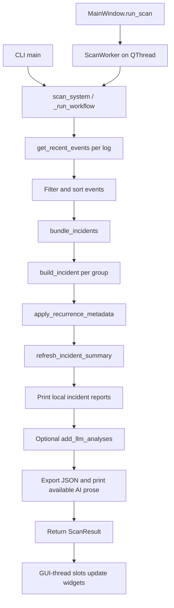

# Code reference

Use this alongside the [README walkthrough](../README.md). Every Python module,
class, function, and method now has a docstring, including private helpers and
test fixtures. Hover over a name in your IDE for its explanation, or use Go to
Definition to read the full contract beside the implementation. Small helpers
have short descriptions; workflow boundaries explain inputs, outputs, failures,
and side effects.

## Where to start

| To understand… | Read… |
| --- | --- |
| The whole scan | `main.scan_system` → `main._run_workflow` |
| Event collection and incomplete results | `event_collection.get_recent_events`, `CollectedEvents` |
| Why events belong together | `incident_detection.bundle_incidents`, `event_similarity_score` |
| Classification, recurrence, and priority | `classify_event`, `apply_recurrence_metadata`, `calculate_incident_score` |
| Which incidents reach OpenAI | `should_analyse_incident_with_llm`, `select_incidents_for_llm`, `add_llm_analyses` |
| API key saving and fallback | `settings/credential_store.py` |
| Preferences and connection checks | `settings/app_settings.py`, `settings/ai_service.py` |
| Desktop threading and navigation | `ui/main_window.py` |
| Displayed evidence and copyable commands | `ui/incident_detail.py` |
| JSON file format and safe replacement | `models/scan_result.py`, `json_reporting.py` |

Names starting with `_` are internal helpers. Qt methods such as `closeEvent`
and `resizeEvent` override framework callbacks; signal connections also invoke
methods that have no ordinary direct call nearby. Small lambdas wire signals,
choose sort keys, or supply test doubles; their surrounding function explains
the operation they support.

## Scan flow and ownership

Collection produces dictionaries; filtering and grouping retain references to
those dictionaries. `build_incident` creates a summary containing the original
event group. Recurrence, score refresh, and AI enrichment mutate summaries.
Rendering reads them without recalculating analysis. JSON conversion creates
supported containers with date/time values converted to strings.

`ScanResult` is a list subclass: `len(result)` counts incidents, while
`result.complete`, `result.coverage`, `result.warnings`, and `result.export_error`
describe scan health. Do not use an empty list as proof that collection succeeded.
AI failure and export failure are separate from collection completeness.

The desktop performs scans and connection tests on worker threads. Signals
deliver outcomes to GUI-thread slots. Windows/dialogs defer closing until workers
stop; result delivery alone is not sufficient to destroy a running thread.

## Data shapes

| Object | Main fields and meaning |
| --- | --- |
| Parsed event | `log_type`, `computer_name`, raw `provider`, numeric `event_id`, datetime `time_generated`, `level`, `message` |
| Incident evidence | `events`, `event_count`, `log_types`, display-only `log_type`, `providers`, `providers_counts`, `event_ids`, `event_ids_counts` |
| Incident timing/classification | `time_generated_start`, `time_generated_end`, timedelta `incident_duration`, `levels`, `highest_severity`, `incident_classification`, `event_classification_counts`, `provider_classifications` |
| Scoring | `incident_score` (capped at 100), `incident_priority`, `incident_score_reasons`, uncapped `incident_score_breakdown`, `summary_text` |
| Recurrence | `recurrence_count_24h`, `recurrence_count_7d`, `is_recurring`, based only on supplied summaries with the same classification |
| AI outcome | `llm_analysis_status`, `llm_analysis_message`; successful `llm_analysis` is a dictionary, failed selected requests also have `llm_analysis_error` |
| Coverage per log | `complete`, `records_read`, `matched_events`, `oldest_time`, `stop_reason`, `window_hours`; an entirely failed log has only completeness, stop reason, and window, with its explanation in scan warnings |
| JSON report | An object with `incidents`, `complete`, `coverage`, `warnings`; exporting a plain list instead preserves the older top-level array format |

AI statuses are `completed`, `disabled`, `not_selected`, and `failed`. An incident
can be ineligible or exceed the per-scan limit; both use `not_selected` with
different explanations. Direct AI calls bypass scan selection but still honor
the enabled preference.

Recurrence windows include their boundaries, the incident itself, and equal-start
incidents. They are grouped by classification, not by machine. No history is
loaded from previous reports, so a 24-hour scan does not establish seven days of
history. Grouping's time limit applies to gaps between events, not total incident
duration. Friendly provider labels are for display, not Windows API identifiers.

## External effects

| Boundary | Effect |
| --- | --- |
| `get_recent_events` | Reads local Windows logs and closes their native handles |
| `AppSettings.load/save` | Reads/writes non-secret current-user QSettings preferences |
| `save/get/delete_openai_api_key` | Accesses the `LogOpen/OpenAI` Windows credential; saving does not authenticate it |
| `resolve_openai_api_key` | Prefers the saved key, then the process `OPENAI_API_KEY` fallback |
| `check_openai_connection` | Retrieves model metadata; no incident data or inference request |
| `analyse_incident_with_llm_result` | Can make a billable request containing incident evidence, including computer names/messages |
| `export_incidents_to_json` | Writes a temporary sibling file and replaces the report only after successful serialization |
| UI copy actions | Writes literal text to the clipboard; never runs diagnostic commands |

Credential and AI errors use fixed messages. `errors.describe_error` merely
normalizes whitespace and must not be treated as a secret-redaction function.
The full scan writes `reports/incidents.json` relative to the working directory.

## Tests, styles, and configuration

`tests/conftest.py` isolates preferences, replaces credential access, and blocks
real socket connections under pytest. `tests/helpers.py` supplies synthetic event
dictionaries. Module-specific tests cover the corresponding helpers; GUI tests
pump the Qt event loop and control worker completion. The regression suite in
`tests/test_scan_regressions.py` covers partial scans, grouping, recurrence, and
export/AI outcomes. Test docstrings explain helpers and individual expectations.

`test_real_llm.py` is a separate manual smoke test. Executing it can send the first
saved incident to OpenAI; importing it during test collection makes no request.

`config.py` holds scan/grouping defaults, provider labels, context limits, allowed
shells, and the AI instructions. Saved AI preferences override the AI defaults.
`ui/style.qss` is organized by commented visual sections. Its `#name` selectors
match widget `objectName` values, and property selectors such as `[state="warning"]`
are refreshed by UI helpers that repolish widgets. The `LogOpen/` directory is the
virtual environment, not application source.

## Function and class index

Entries below link to their source definitions. Full docstrings remain beside
the code; update this index when adding, renaming, or substantially changing a
function. Test helpers are documented in the test files rather than repeated here.

### [config.py](../config.py)

Shared defaults for collection, grouping, scoring inputs, and AI prompts.

This module defines configuration or a package boundary; it has no functions/classes.

### [errors.py](../errors.py)

Application exceptions and single-line formatting for non-secret errors.

| Name | Purpose |
| --- | --- |
| [`LogOpenError`](../errors.py#L4) | Base class for expected, user-facing LogOpen failures. |
| [`EventCollectionError`](../errors.py#L8) | Raised when a configured Windows Event Log cannot be read. |
| [`LLMAnalysisError`](../errors.py#L12) | Raised when optional LLM analysis cannot be completed. |
| [`ReportExportError`](../errors.py#L16) | Raised when an incident report cannot be written safely. |
| [`describe_error`](../errors.py#L20) | Return collapsed exception text, or its class name if the text is empty. |

### [event_collection.py](../event_collection.py)

Read local Windows Event Logs and retain evidence of scan coverage.

| Name | Purpose |
| --- | --- |
| [`CollectedEvents`](../event_collection.py#L27) | List of parsed event dictionaries with per-log collection metadata. |
| [`CollectedEvents.__init__`](../event_collection.py#L40) | Initialize an empty result with complete coverage and no warnings. |
| [`CollectedEvents.coverage`](../event_collection.py#L49) | Return a new coverage dictionary, including the current matched-event count. |
| [`CollectedEvents.warn`](../event_collection.py#L63) | Mark coverage incomplete and append/log the message only if it is new. |
| [`_require_event_log_dependencies`](../event_collection.py#L71) | Raise EventCollectionError when the pywin32 event-log imports failed. |
| [`log_event_level`](../event_collection.py#L84) | Map a raw record's EventType to a readable severity, or Unknown. |
| [`parse_event`](../event_collection.py#L106) | Convert one raw Windows record into LogOpen's event dictionary. |
| [`get_recent_events`](../event_collection.py#L160) | Read a local log backward until its time boundary, EOF, or record cap. |

### [event_filtering.py](../event_filtering.py)

Filters collected event dictionaries by severity and recency.

| Name | Purpose |
| --- | --- |
| [`filter_events`](../event_filtering.py#L6) | Return a new list of events whose level belongs to filter_criteria. |
| [`filter_events_by_time`](../event_filtering.py#L20) | Return events newer than now minus hours, preserving input order. |

### [incident_classification.py](../incident_classification.py)

Maps Windows event providers and patterns to readable incident labels.

| Name | Purpose |
| --- | --- |
| [`classify_provider`](../incident_classification.py#L6) | Return a configured display label, or clean a raw provider name. |
| [`classify_dcom_event`](../incident_classification.py#L26) | Choose a DCOM label from event_id and an already lowercased message. |
| [`classify_service_event`](../incident_classification.py#L52) | Label a service termination using an already lowercased message. |
| [`classify_event`](../incident_classification.py#L64) | Classify an event using provider, event_id, and message evidence. |
| [`classify_incident`](../incident_classification.py#L93) | Return a raw-provider-to-display-label dictionary for incident['providers']. |

### [incident_detection.py](../incident_detection.py)

Groups related events into incidents and builds their summary dictionaries.

| Name | Purpose |
| --- | --- |
| [`_join_readable`](../incident_detection.py#L31) | Join string values with commas/and; use unknown providers for empty input. |
| [`_format_duration`](../incident_detection.py#L43) | Format a timedelta as hours, minutes, and seconds in natural language. |
| [`_format_score_reasons`](../incident_detection.py#L67) | Turn scoring-reason strings into a readable clause for summary_text. |
| [`_build_summary_text`](../incident_detection.py#L98) | Return a deterministic paragraph from a fully populated incident summary. |
| [`refresh_incident_summary`](../incident_detection.py#L128) | Recalculate score, priority, reasons, breakdown, and summary_text in place. |
| [`normalize_component_name`](../incident_detection.py#L150) | Lowercase a string, replace hyphens/underscores, and collapse whitespace. |
| [`extract_event_components`](../incident_detection.py#L158) | Return normalized component names found in provider and message text. |
| [`component_similarity_score`](../incident_detection.py#L179) | Return +3 for shared components, -3 for disjoint known ones, or zero. |
| [`event_similarity_score`](../incident_detection.py#L197) | Return a nonnegative relationship score for two event dictionaries. |
| [`bundle_incidents`](../incident_detection.py#L234) | Group related events chronologically, including interleaved sequences. |
| [`bundle_incidents.keys`](../incident_detection.py#L258) | Build computer-scoped provider/component index keys for one event. |
| [`bundle_incidents.unindex`](../incident_detection.py#L266) | Remove a group's last-event memberships from the candidate indexes. |
| [`build_incident`](../incident_detection.py#L302) | Summarize one chronological event group and calculate its initial score. |

### [incident_recurrence.py](../incident_recurrence.py)

Annotate incident summaries with deterministic classification recurrence data.

| Name | Purpose |
| --- | --- |
| [`apply_recurrence_metadata`](../incident_recurrence.py#L13) | Add classification recurrence counts and is_recurring to each summary. |

### [incident_scoring.py](../incident_scoring.py)

Deterministic incident scoring with explainable category contributions.

| Name | Purpose |
| --- | --- |
| [`get_incident_priority`](../incident_scoring.py#L27) | Map a nonnegative score to Low, Medium, High, or Critical. |
| [`_add_score`](../incident_scoring.py#L40) | Add nonzero points to an existing breakdown category and append its reason. |
| [`_get_duration_score`](../incident_scoring.py#L51) | Return (points, reason) for a timedelta, with None when no points apply. |
| [`calculate_incident_score`](../incident_scoring.py#L67) | Return a capped score, explanation list, and uncapped category breakdown. |

### [json_reporting.py](../json_reporting.py)

Convert incident data to JSON and atomically replace report files.

| Name | Purpose |
| --- | --- |
| [`make_json_safe`](../json_reporting.py#L17) | Copy supported report containers and convert their date/time values. |
| [`export_incidents_to_json`](../json_reporting.py#L51) | Write a readable UTF-8 report, replacing the destination after serialization. |

### [llm_analysis.py](../llm_analysis.py)

Select incidents for optional AI analysis and validate structured responses.

| Name | Purpose |
| --- | --- |
| [`AIAnalysisResult`](../llm_analysis.py#L25) | Immutable outcome carrying status, a display-safe message, and optional analysis. |
| [`_format_mapping`](../llm_analysis.py#L37) | Render metadata as key/value pairs, a string, or semicolon-separated items. |
| [`_clean_message`](../llm_analysis.py#L52) | Strip empty lines and bound a source message using MAX_MESSAGE_LENGTH. |
| [`_format_events`](../llm_analysis.py#L72) | Render the first MAX_CONTEXT_EVENTS source entries for the prompt. |
| [`build_incident_context`](../llm_analysis.py#L115) | Build prompt text from an incident's evidence, scores, and recurrence fields. |
| [`_coerce_incident_analysis`](../llm_analysis.py#L178) | Return an existing IncidentAnalysis or validate a dictionary into one. |
| [`_log_llm_failure`](../llm_analysis.py#L192) | Write a pre-sanitized failure message to stderr, ignoring output errors. |
| [`should_analyse_incident_with_llm`](../llm_analysis.py#L204) | Decide eligibility without making an API request or modifying the incident. |
| [`select_incidents_for_llm`](../llm_analysis.py#L232) | Return eligible incidents sorted by descending score, up to the saved limit. |
| [`build_analysis_instructions`](../llm_analysis.py#L252) | Append configured diagnostic shell rules to the base analysis instructions. |
| [`_analysis_failure`](../llm_analysis.py#L281) | Log a fixed safe message and return a failed AIAnalysisResult with no analysis. |
| [`analyse_incident_with_llm_result`](../llm_analysis.py#L287) | Request and validate one structured AI analysis, returning an explicit outcome. |
| [`analyse_incident_with_llm`](../llm_analysis.py#L373) | Return only the IncidentAnalysis, or None for a disabled/failed request. |

### [main.py](../main.py)

Coordinate collection, deterministic analysis, optional AI, and report export.

| Name | Purpose |
| --- | --- |
| [`format_log_types_label`](../main.py#L31) | Return a readable log-name phrase, with a fallback for an empty sequence. |
| [`display_llm_analysis`](../main.py#L43) | Print the four prose fields of a validated analysis dictionary to stdout. |
| [`_write_status`](../main.py#L63) | Print to stdout, or stderr when error=True, ignoring broken output streams. |
| [`add_llm_analyses`](../main.py#L75) | Attach optional analysis and an explicit AI outcome to summaries in place. |
| [`_validate_log_types`](../main.py#L132) | Require a nonempty list/tuple of nonblank log-name strings. |
| [`_run_workflow`](../main.py#L147) | Run collection through export, preserving usable results from partial scans. |
| [`scan_system`](../main.py#L273) | Run the full workflow and return a ScanResult for CLI or desktop callers. |
| [`main`](../main.py#L284) | Run a CLI scan and return its process exit code. |

### [models/__init__.py](../models/__init__.py)

Data models shared by scanning, optional AI analysis, and presentation.

This module defines configuration or a package boundary; it has no functions/classes.

### [models/incident_analysis.py](../models/incident_analysis.py)

Pydantic schemas for structured AI explanations and diagnostic suggestions.

| Name | Purpose |
| --- | --- |
| [`DiagnosticStep`](../models/incident_analysis.py#L9) | One diagnostic suggestion with an optional command and an explicit risk. |
| [`DiagnosticStep.validate_command_shell`](../models/incident_analysis.py#L28) | Return this step, rejecting a shell when command text is absent or blank. |
| [`IncidentAnalysis`](../models/incident_analysis.py#L39) | Structured explanation accepted from the OpenAI parsing response. |

### [models/scan_result.py](../models/scan_result.py)

Scan results with coverage and reporting status, including empty scans.

| Name | Purpose |
| --- | --- |
| [`ScanResult`](../models/scan_result.py#L4) | Incident list with collection and reporting metadata, even when empty. |
| [`ScanResult.__init__`](../models/scan_result.py#L18) | Shallow-copy incidents into the list and initialize empty scan metadata. |
| [`ScanResult.as_report`](../models/scan_result.py#L29) | Return the incidents/complete/coverage/warnings envelope used for export. |

### [settings/__init__.py](../settings/__init__.py)

Persistent preferences and OS-backed credentials for LogOpen.

This module defines configuration or a package boundary; it has no functions/classes.

### [settings/ai_service.py](../settings/ai_service.py)

Small OpenAI client boundary shared by analysis and connection testing.

| Name | Purpose |
| --- | --- |
| [`MissingCredentialsError`](../settings/ai_service.py#L6) | Signal that neither secure storage nor the environment supplied a key. |
| [`MissingCredentialsError.__init__`](../settings/ai_service.py#L8) | Initialize a fixed missing-key message suitable for user-facing handling. |
| [`create_openai_client`](../settings/ai_service.py#L13) | Resolve credentials and construct an OpenAI client for the official endpoint. |
| [`check_openai_connection`](../settings/ai_service.py#L40) | Check credentials and model metadata access without running incident analysis. |

### [settings/app_settings.py](../settings/app_settings.py)

Store only non-secret AI preferences in the current user's QSettings.

| Name | Purpose |
| --- | --- |
| [`SettingsError`](../settings/app_settings.py#L14) | A settings failure with a fixed, safe user-facing message. |
| [`AISettings`](../settings/app_settings.py#L19) | Immutable preference snapshot: enabled flag, model name, and scan request limit. |
| [`validate_model`](../settings/app_settings.py#L30) | Return a trimmed model identifier after local syntax validation. |
| [`_limit`](../settings/app_settings.py#L45) | Parse an integer-like preference and clamp it to 1-20, or return default. |
| [`_enabled`](../settings/app_settings.py#L59) | Accept only True, integer 1, or case-insensitive text true/1 as enabled. |
| [`_create_qsettings`](../settings/app_settings.py#L70) | Create current-user native storage for organization/application LogOpen. |
| [`AppSettings`](../settings/app_settings.py#L82) | Load and persist non-secret AI preferences through a QSettings-like backend. |
| [`AppSettings.__init__`](../settings/app_settings.py#L88) | Use an injected storage backend, or create native current-user QSettings. |
| [`AppSettings.load`](../settings/app_settings.py#L95) | Return validated AISettings, using config defaults for missing preferences. |
| [`AppSettings.save`](../settings/app_settings.py#L121) | Validate preferences, write the three AI values, and synchronize storage. |

### [settings/credential_store.py](../settings/credential_store.py)

Store the OpenAI key in Windows Credential Manager and resolve its fallback.

| Name | Purpose |
| --- | --- |
| [`CredentialStoreError`](../settings/credential_store.py#L16) | Credential storage failure with fixed text suitable for display to the user. |
| [`CredentialStoreError.__init__`](../settings/credential_store.py#L18) | Construct the safe storage error without accepting backend exception text. |
| [`_backend`](../settings/credential_store.py#L23) | Load the pywin32 interface to Windows Credential Manager on demand. |
| [`save_openai_api_key`](../settings/credential_store.py#L42) | Validate and immediately save or replace the user's OpenAI credential. |
| [`get_openai_api_key`](../settings/credential_store.py#L78) | Read and return the saved secret, or None if absent/blank. |
| [`delete_openai_api_key`](../settings/credential_store.py#L101) | Delete the saved credential immediately; a missing entry is a no-op. |
| [`environment_key_configured`](../settings/credential_store.py#L115) | Return whether OPENAI_API_KEY contains nonblank text, without exposing it. |
| [`resolve_openai_api_key`](../settings/credential_store.py#L120) | Return the saved key, falling back to the process environment when needed. |
| [`credential_status`](../settings/credential_store.py#L141) | Return display-safe text describing configured, missing, or unavailable keys. |

### [terminal_reporting.py](../terminal_reporting.py)

Renders incident summaries and source event messages for the terminal.

| Name | Purpose |
| --- | --- |
| [`clean_message`](../terminal_reporting.py#L8) | Strip blank lines from message text, preserving remaining line breaks. |
| [`_print_incident_mapping`](../terminal_reporting.py#L20) | Print a heading and mapping entries to out using the requested separator. |
| [`_print_incident_events`](../terminal_reporting.py#L30) | Write numbered source-event metadata and cleaned messages to the output stream. |
| [`_print_incident_summary`](../terminal_reporting.py#L45) | Print one indexed incident's supplied metadata, counts, and source events. |
| [`display_incident_reports`](../terminal_reporting.py#L83) | Write incident summaries to out, defaulting to sys.stdout. |

### [test_real_llm.py](../test_real_llm.py)

Manual AI smoke test using the first incident in reports/incidents.json.

| Name | Purpose |
| --- | --- |
| [`main`](../test_real_llm.py#L12) | Load a report envelope/legacy array and print analysis of its first incident. |

### [ui/__init__.py](../ui/__init__.py)

PyQt desktop views and workers for scanning, incident inspection, and settings.

This module defines configuration or a package boundary; it has no functions/classes.

### [ui/incident_detail.py](../ui/incident_detail.py)

Read-only incident presentation. This module never scans or requests analysis.

| Name | Purpose |
| --- | --- |
| [`_text`](../ui/incident_detail.py#L16) | Render supported scalar values or lists/tuples, with a fallback for missing data. |
| [`_body_label`](../ui/incident_detail.py#L30) | Create a selectable plain-text label that wraps without forcing horizontal width. |
| [`_section`](../ui/incident_detail.py#L41) | Return a styled section frame and its vertical layout, already containing a title. |
| [`_scroll_page`](../ui/incident_detail.py#L52) | Return a vertically scrollable page and the layout used to populate its contents. |
| [`_field_form`](../ui/incident_detail.py#L68) | Build a wrapping metadata form and return its layout plus key-to-value-label mapping. |
| [`DiagnosticStepWidget`](../ui/incident_detail.py#L86) | A recommendation card; the only command action copies text to the clipboard. |
| [`DiagnosticStepWidget.__init__`](../ui/incident_detail.py#L89) | Render a numbered diagnostic description, risk, and optional command. |
| [`SourceEventsWidget`](../ui/incident_detail.py#L148) | Select a source event and read its complete, literal message. |
| [`SourceEventsWidget.__init__`](../ui/incident_detail.py#L151) | Build an event-selector table and read-only message reader in a vertical splitter. |
| [`SourceEventsWidget.set_events`](../ui/incident_detail.py#L208) | Replace the event list and select its first valid dictionary, if present. |
| [`SourceEventsWidget._show_selected_event`](../ui/incident_detail.py#L239) | Display the selected event metadata and literal full message, resetting message scroll. |
| [`IncidentDetailWidget`](../ui/incident_detail.py#L263) | A full incident page with overview, existing AI analysis, and source events. |
| [`IncidentDetailWidget.__init__`](../ui/incident_detail.py#L268) | Build overview, AI, and source-event tabs and wire Back keyboard shortcuts. |
| [`IncidentDetailWidget._set_diagnostic_steps`](../ui/incident_detail.py#L416) | Replace diagnostic cards with supplied dictionary steps and update the empty state. |
| [`IncidentDetailWidget.resizeEvent`](../ui/incident_detail.py#L435) | Process the Qt resize event, then adapt the overview layout to available width. |
| [`IncidentDetailWidget._arrange_overview`](../ui/incident_detail.py#L440) | Use overview columns at widths of at least 900 pixels; otherwise stack sections. |
| [`IncidentDetailWidget.set_incident`](../ui/incident_detail.py#L453) | Replace all displayed fields from an incident dictionary, or clear the view. |

### [ui/main_window.py](../ui/main_window.py)

Desktop dashboard, incident navigation, and background scan coordination.

| Name | Purpose |
| --- | --- |
| [`_label`](../ui/main_window.py#L38) | Create a named QLabel that treats its text literally, not as HTML. |
| [`_metric_card`](../ui/main_window.py#L46) | Return a styled dashboard card and its value label for subsequent updates. |
| [`ScanWorker`](../ui/main_window.py#L63) | Run a blocking scan off the GUI thread without accessing widgets. |
| [`ScanWorker.run`](../ui/main_window.py#L77) | Execute scan_system and emit success/error, followed by finished in finally. |
| [`MainWindow`](../ui/main_window.py#L94) | Own the dashboard, incident-detail page, settings dialog, and scan worker. |
| [`MainWindow.run_scan`](../ui/main_window.py#L102) | Clear old results and launch one ScanWorker on a fresh QThread. |
| [`MainWindow._show_scan_results`](../ui/main_window.py#L143) | Render results and coverage warnings on the GUI thread after worker success. |
| [`MainWindow._show_scan_error`](../ui/main_window.py#L190) | Clear stale results and display a failed-scan state on the GUI thread. |
| [`MainWindow._scan_finished`](../ui/main_window.py#L204) | Release stopped-thread/worker references and re-enable controls. |
| [`MainWindow.closeEvent`](../ui/main_window.py#L218) | Defer closing while settings or scanning owns active asynchronous work. |
| [`MainWindow._open_settings`](../ui/main_window.py#L238) | Open a single modal SettingsDialog without blocking Qt's event loop. |
| [`MainWindow._settings_closed`](../ui/main_window.py#L251) | Drop the dialog reference and schedule a pending parent-window close. |
| [`MainWindow._set_state`](../ui/main_window.py#L257) | Set the state badge text/property and repolish its stylesheet immediately. |
| [`MainWindow._show_empty_state`](../ui/main_window.py#L264) | Set the placeholder symbol, title, and description and show its page. |
| [`MainWindow._populate_incident_table`](../ui/main_window.py#L271) | Populate read-only rows while retaining each source dictionary's identity. |
| [`MainWindow._clear_incidents`](../ui/main_window.py#L308) | Clear stored incidents, table, and detail page and return to the dashboard. |
| [`MainWindow._selected_incident`](../ui/main_window.py#L316) | Return the selected row's source dictionary, or None for an invalid selection. |
| [`MainWindow._open_incident_detail`](../ui/main_window.py#L335) | Show the selected incident in the detail page and focus its Back button. |
| [`MainWindow._show_incident_list`](../ui/main_window.py#L345) | Return to the dashboard and table focus, preserving the current selection. |
| [`MainWindow._copy_selected_rows`](../ui/main_window.py#L355) | Copy selected table rows as tab-separated text to the system clipboard. |
| [`MainWindow._update_copy_action`](../ui/main_window.py#L368) | Enable copy/detail actions only when the table has a selection. |
| [`MainWindow.__init__`](../ui/main_window.py#L373) | Build the dashboard/detail widgets, connect actions, and load the stylesheet. |
| [`main`](../ui/main_window.py#L596) | Create the QApplication, show MainWindow, and enter the Qt event loop. |

### [ui/settings_dialog.py](../ui/settings_dialog.py)

AI preferences dialog; credentials stay in the settings service layer.

| Name | Purpose |
| --- | --- |
| [`_label`](../ui/settings_dialog.py#L14) | Create a named, wrapping QLabel with literal text rendering. |
| [`_button`](../ui/settings_dialog.py#L23) | Create a styled button, disable implicit default activation, and connect its slot. |
| [`ConnectionTestWorker`](../ui/settings_dialog.py#L34) | Run a model-metadata connection check away from the GUI thread. |
| [`ConnectionTestWorker.__init__`](../ui/settings_dialog.py#L43) | Store the model to check and initialize the worker without a QObject parent. |
| [`ConnectionTestWorker.run`](../ui/settings_dialog.py#L49) | Call the connection service and emit its result, always followed by finished. |
| [`SettingsDialog`](../ui/settings_dialog.py#L64) | Edit non-secret AI preferences and invoke immediate secure-key operations. |
| [`SettingsDialog.__init__`](../ui/settings_dialog.py#L71) | Build settings controls and load preferences plus credential-status text. |
| [`SettingsDialog._message`](../ui/settings_dialog.py#L183) | Set a display-safe feedback message and refresh its success/error styling. |
| [`SettingsDialog._refresh_key_status`](../ui/settings_dialog.py#L190) | Refresh the availability label through credential_status without filling the key input. |
| [`SettingsDialog._save_key`](../ui/settings_dialog.py#L197) | Save the typed credential immediately and report validation/storage failure. |
| [`SettingsDialog._remove_key`](../ui/settings_dialog.py#L217) | Clear typed text and remove the saved credential, then refresh its status. |
| [`SettingsDialog._save_preferences`](../ui/settings_dialog.py#L232) | Validate controls and persist AISettings, returning whether saving succeeded. |
| [`SettingsDialog._test_connection`](../ui/settings_dialog.py#L254) | Save preferences and launch one background model-metadata access check. |
| [`SettingsDialog._set_testing`](../ui/settings_dialog.py#L281) | Toggle edit/test controls and progress text while a connection worker runs. |
| [`SettingsDialog._show_test_result`](../ui/settings_dialog.py#L290) | Display a worker connection result on the GUI thread using the supplied success flag. |
| [`SettingsDialog._test_finished`](../ui/settings_dialog.py#L295) | Release completed worker/thread references and restore editable controls. |
| [`SettingsDialog.done`](../ui/settings_dialog.py#L306) | Clear typed secret text and finish, or defer the result until the worker stops. |
| [`SettingsDialog.closeEvent`](../ui/settings_dialog.py#L319) | Clear the password input and defer the Qt close event if a connection test is active. |
