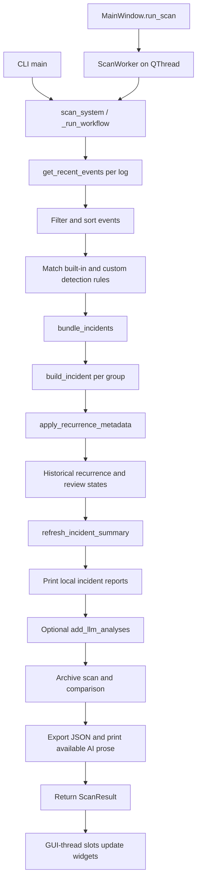

# Code reference

Use this alongside the [README walkthrough](../README.md). Every Python module,
class, function, and method now has a docstring, including private helpers and
test fixtures. Hover over a name in your IDE for its explanation, or use Go to
Definition to read the full contract beside the implementation. Small helpers
have short descriptions; workflow boundaries explain inputs, outputs, failures,
and side effects.

## Where to start

| To understand… | Read… |
| --- | --- |
| The whole scan | `main.scan_system` → `main._run_workflow` |
| Event collection and incomplete results | `event_collection.get_recent_events`, `CollectedEvents` |
| Modern XML event ingestion and channel access | `windows_events.py`, `channel_catalog.py` |
| Scan presets and custom detection rules | `detection_rules.py`, `ui/rule_editor.py` |
| Cross-channel event timelines | `ui/timeline.py` |
| Periodic monitoring and notification deduplication | `monitoring.py`, `ui/monitoring.py` |
| Why events belong together | `incident_detection.bundle_incidents`, `event_similarity_score` |
| Classification, recurrence, and priority | `classify_event`, `apply_recurrence_metadata`, `calculate_incident_score` |
| Which incidents reach OpenAI | `should_analyse_incident_with_llm`, `select_incidents_for_llm`, `add_llm_analyses` |
| API key saving and fallback | `settings/credential_store.py` |
| Preferences and connection checks | `settings/app_settings.py`, `settings/ai_service.py` |
| Desktop threading and navigation | `ui/main_window.py` |
| Historical recurrence, comparisons, and review state | `history_store.py` |
| Search, exports, history browsing, and manual AI | `ui/workspace.py` |
| Scope controls, cancellation, and progress | `models/scan_options.py`, `main.py`, `ui/scan_controls.py` |
| Optional visual motion | `ui/animations.py` |
| Wide table columns and screen-aware window sizing | `ui/table_layout.py` |
| Saved report loading and CSV/Markdown exports | `report_io.py` |
| Displayed evidence and copyable commands | `ui/incident_detail.py` |
| JSON file format and safe replacement | `models/scan_result.py`, `json_reporting.py` |

Names starting with `_` are internal helpers. Qt methods such as `closeEvent`
and `resizeEvent` override framework callbacks; signal connections also invoke
methods that have no ordinary direct call nearby. Small lambdas wire signals,
choose sort keys, or supply test doubles; their surrounding function explains
the operation they support.

## Scan flow and ownership

Collection produces dictionaries; filtering and grouping retain references to
those dictionaries. `build_incident` creates a summary containing the original
event group. Recurrence, score refresh, and AI enrichment mutate summaries.
Rendering reads them without recalculating analysis. JSON conversion creates
supported containers with date/time values converted to strings.

`ScanResult` is a list subclass: `len(result)` counts incidents, while
`result.complete`, `result.coverage`, `result.warnings`, and `result.export_error`
describe scan health. Do not use an empty list as proof that collection succeeded.
AI failure and export failure are separate from collection completeness.

The desktop performs scans and connection tests on worker threads. Signals
deliver outcomes to GUI-thread slots. Windows/dialogs defer closing until workers
stop; result delivery alone is not sufficient to destroy a running thread.

## Data shapes

| Object | Main fields and meaning |
| --- | --- |
| Parsed event | `log_type`, `computer_name`, raw `provider`, numeric `event_id`, datetime `time_generated`, `level`, `message` |
| Modern evidence | UTC timestamp, `record_number`, repeated-name-safe `event_data`, `keywords`, optional ActivityID/RelatedActivityID/ProcessID/ThreadID |
| Detection annotations | `detection_rules`, `detection_classification`, `detection_severity`; the original Windows `level` is preserved |
| Scan options | Channels, hours, cap, profile, canonical `rules_json`, `automatic_ai`, and detection version; rules/version participate in history comparisons |
| Incident evidence | `events`, `event_count`, `log_types`, display-only `log_type`, `providers`, `providers_counts`, `event_ids`, `event_ids_counts` |
| Incident timing/classification | `time_generated_start`, `time_generated_end`, timedelta `incident_duration`, `levels`, `highest_severity`, `incident_classification`, `event_classification_counts`, `provider_classifications` |
| Scoring | `incident_score` (capped at 100), `incident_priority`, `incident_score_reasons`, uncapped `incident_score_breakdown`, `summary_text` |
| Recurrence | `recurrence_count_24h`, `recurrence_count_7d`, `is_recurring`; the full workflow combines current and deduplicated historical observations |
| Review state | `review_state`: active, acknowledged, or ignored; saved by issue family and applied to later scans |
| AI outcome | `llm_analysis_status`, `llm_analysis_message`; successful `llm_analysis` is a dictionary, failed selected requests also have `llm_analysis_error` |
| Coverage per log | `complete`, `records_read`, `matched_events`, `oldest_time`, `stop_reason`, `window_hours`; an entirely failed log has only completeness, stop reason, and window, with its explanation in scan warnings |
| JSON report | `incidents`, `complete`, `coverage`, `warnings`, `cancelled`, `scan_id`, `created_at`, `scan_options`, `comparison`; a plain-list export preserves the older array format |

AI statuses are `completed`, `disabled`, `not_selected`, and `failed`. An incident
can be ineligible or exceed the per-scan limit; both use `not_selected` with
different explanations. Direct AI calls bypass scan selection but still honor
the enabled preference.

Recurrence windows include their boundaries, the incident itself, and equal-start
incidents. The standalone helper groups by classification. The normal workflow
adds historical recurrence grouped by machine and classification, using retained
SQLite snapshots and shared source-event evidence to deduplicate overlapping scans.
Unscanned periods remain unknown. Grouping's time limit applies to gaps between events, not total incident
duration. Friendly provider labels are for display, not Windows API identifiers.

## External effects

| Boundary | Effect |
| --- | --- |
| `get_recent_events` | Reads local Windows logs and closes their native handles |
| `list_channels` / `check_channels` | Enumerates OS channel metadata and probes selected read access without changing logging or permissions |
| `MonitorController` | Periodic local scans, SQLite/report writes, and optional count-only desktop notifications; automatic AI is always off |
| `AppSettings.load/save` | Reads/writes non-secret current-user QSettings preferences |
| `save/get/delete_openai_api_key` | Accesses the `LogOpen/OpenAI` Windows credential; saving does not authenticate it |
| `resolve_openai_api_key` | Prefers the saved key, then the process `OPENAI_API_KEY` fallback |
| `check_openai_connection` | Retrieves model metadata; no incident data or inference request |
| `analyse_incident_with_llm_result` | Can make a billable request containing incident evidence, including computer names/messages |
| `export_incidents_to_json` | Writes a temporary sibling file and replaces the report only after successful serialization |
| `HistoryStore` | Reads/writes per-user SQLite scan snapshots and review states, with per-operation connections |
| `load_report` | Reads and validates a selected JSON file without scanning or running analysis |
| `export_selected` | Writes chosen rows as JSON, formula-safe CSV, or readable Markdown |
| UI copy actions | Writes literal text to the clipboard; never runs diagnostic commands |

Credential and AI errors use fixed messages. `errors.describe_error` merely
normalizes whitespace and must not be treated as a secret-redaction function.
The full scan writes `reports/incidents.json` relative to the working directory.

## Tests, styles, and configuration

`tests/conftest.py` isolates preferences, replaces credential access, and blocks
real socket connections under pytest. `tests/helpers.py` supplies synthetic event
dictionaries. Module-specific tests cover the corresponding helpers; GUI tests
pump the Qt event loop and control worker completion. The regression suite in
`tests/test_scan_regressions.py` covers partial scans, grouping, recurrence, and
export/AI outcomes. Test docstrings explain helpers and individual expectations.

`test_real_llm.py` is a separate manual smoke test. Executing it can send the first
saved incident to OpenAI; importing it during test collection makes no request.

`config.py` holds scan/grouping defaults, provider labels, context limits, allowed
shells, and the AI instructions. Saved AI preferences override the AI defaults;
the desktop persists scan scope separately and passes an immutable ScanOptions.
`ui/style.qss` is organized by commented visual sections. Its `#name` selectors
match widget `objectName` values, and property selectors such as `[state="warning"]`
are refreshed by UI helpers that repolish widgets. The `LogOpen/` directory is the
virtual environment, not application source.

## Function and class index

Source docstrings describe contracts, side effects, and failures. Test helpers are documented in their files.

### [channel_catalog.py](../channel_catalog.py)

Discover local event channels and check access without enabling or editing logs.

| Name | Purpose |
| --- | --- |
| [`list_channels`](../channel_catalog.py#L7) | Return name, kind, enabled state, and description for registered channels. |
| [`check_channels`](../channel_catalog.py#L44) | Probe reverse-query/read access to selected channels, retaining no event data. |

### [config.py](../config.py)

Shared defaults for collection, grouping, scoring inputs, and AI prompts.

Configuration or package boundary; no functions or classes.

### [desktop.py](../desktop.py)

Launch LogOpen's desktop interface, including a noninteractive bundle check.

| Name | Purpose |
| --- | --- |
| [`_prepare_runtime`](../desktop.py#L16) | Provide output streams and choose a writable directory when frozen. |
| [`_check_optional_runtime`](../desktop.py#L33) | Check native imports and an offline AI client without using saved secrets. |
| [`main`](../desktop.py#L54) | Start Qt and return its exit code, or validate a hidden UI and return zero. |

### [detection_rules.py](../detection_rules.py)

Small declarative detection rules, matched by channel, provider, and event ID.

| Name | Purpose |
| --- | --- |
| [`_rule`](../detection_rules.py#L37) | Build a built-in rule with the same inspectable schema as custom rules. |
| [`parse_custom_rules`](../detection_rules.py#L58) | Validate a JSON array of at most 100 exact-match rules and return copies. |
| [`RuleSet`](../detection_rules.py#L102) | Index one immutable scan's rules by provider and ID for efficient matching. |
| [`RuleSet.__init__`](../detection_rules.py#L105) | Validate custom rules and give them precedence over built-in labels. |
| [`RuleSet.matches`](../detection_rules.py#L113) | Return matching rules without modifying Windows evidence or event severity. |
| [`RuleSet.apply`](../detection_rules.py#L119) | Annotate matching rules and return whether the event deserves inclusion. |

### [errors.py](../errors.py)

Application exceptions and single-line formatting for non-secret errors.

| Name | Purpose |
| --- | --- |
| [`LogOpenError`](../errors.py#L4) | Base class for expected, user-facing LogOpen failures. |
| [`EventCollectionError`](../errors.py#L8) | Raised when a configured Windows Event Log cannot be read. |
| [`LLMAnalysisError`](../errors.py#L12) | Raised when optional LLM analysis cannot be completed. |
| [`ReportExportError`](../errors.py#L16) | Raised when an incident report cannot be written safely. |
| [`describe_error`](../errors.py#L20) | Return collapsed exception text, or its class name if the text is empty. |

### [event_collection.py](../event_collection.py)

Read local Windows Event Logs and retain evidence of scan coverage.

| Name | Purpose |
| --- | --- |
| [`CollectedEvents`](../event_collection.py#L28) | List of parsed event dictionaries with per-log collection metadata. |
| [`CollectedEvents.__init__`](../event_collection.py#L41) | Initialize an empty result with complete coverage and no warnings. |
| [`CollectedEvents.coverage`](../event_collection.py#L50) | Return a new coverage dictionary, including the current matched-event count. |
| [`CollectedEvents.warn`](../event_collection.py#L64) | Mark coverage incomplete and append/log the message only if it is new. |
| [`_require_event_log_dependencies`](../event_collection.py#L72) | Raise EventCollectionError when the pywin32 event-log imports failed. |
| [`log_event_level`](../event_collection.py#L85) | Map a raw record's EventType to a readable severity, or Unknown. |
| [`parse_event`](../event_collection.py#L107) | Convert one raw Windows record into LogOpen's event dictionary. |
| [`get_classic_events`](../event_collection.py#L165) | Read a local log backward until its time boundary, EOF, or record cap. |
| [`get_classic_events.cancellation_requested`](../event_collection.py#L207) | Mark retained records incomplete when the caller's cancellation token is set. |
| [`get_recent_events`](../event_collection.py#L301) | Read a channel using EvtQuery, including operational and audit channels. |

### [event_filtering.py](../event_filtering.py)

Filters collected event dictionaries by severity and recency.

| Name | Purpose |
| --- | --- |
| [`filter_events`](../event_filtering.py#L6) | Return a new list of events whose level belongs to filter_criteria. |
| [`filter_events_by_time`](../event_filtering.py#L20) | Return events newer than now minus hours, preserving input order. |

### [history_store.py](../history_store.py)

Persist local scans, compare matching scopes, and remember incident review state.

| Name | Purpose |
| --- | --- |
| [`HistoryStoreError`](../history_store.py#L23) | The local history database could not be read or written. |
| [`_canonical`](../history_store.py#L27) | Serialize supported report values deterministically for keys and database rows. |
| [`_timestamp`](../history_store.py#L32) | Normalize aware/local-naive timestamps to comparable UTC seconds. |
| [`_scope`](../history_store.py#L39) | Normalize scan scope so equivalent log orderings compare equally. |
| [`_options`](../history_store.py#L59) | Copy user-facing scope metadata from a dictionary or ScanOptions object. |
| [`incident_key`](../history_store.py#L68) | Return a stable issue-family key across occurrences, scans, and event counts. |
| [`_evidence_keys`](../history_store.py#L84) | Identify individual event evidence so overlapping scans count it only once. |
| [`HistoryStore`](../history_store.py#L100) | Access local scan snapshots and issue states with short-lived connections. |
| [`HistoryStore.__init__`](../history_store.py#L103) | Choose a database file without opening it or creating directories. |
| [`HistoryStore._connection`](../history_store.py#L117) | Open/initialize SQLite, commit successful work, and always release the handle. |
| [`HistoryStore.save_scan`](../history_store.py#L152) | Save a full snapshot and attach scan_id, created_at, and scan_options. |
| [`HistoryStore.update_scan`](../history_store.py#L180) | Replace an existing snapshot after manual analysis, preserving its identity/scope. |
| [`HistoryStore.list_scans`](../history_store.py#L188) | Return newest-first lightweight scan metadata without deserializing evidence. |
| [`HistoryStore.load_scan`](../history_store.py#L200) | Restore one saved ScanResult and overlay the current issue review states. |
| [`HistoryStore.apply_states`](../history_store.py#L211) | Attach active/acknowledged/ignored state to each supplied incident in place. |
| [`HistoryStore.set_state`](../history_store.py#L219) | Persist review state for this issue family and update the passed dictionary. |
| [`HistoryStore.compare_scan`](../history_store.py#L227) | Compare issue families against the latest suitable saved scope. |
| [`HistoryStore.enrich_incidents`](../history_store.py#L263) | Add seven-day recurrence using distinct observed incident occurrences. |
| [`HistoryStore.enrich_incidents.find`](../history_store.py#L291) | Find a merged occurrence representative with path compression. |

### [incident_classification.py](../incident_classification.py)

Maps Windows event providers and patterns to readable incident labels.

| Name | Purpose |
| --- | --- |
| [`classify_provider`](../incident_classification.py#L6) | Return a configured display label, or clean a raw provider name. |
| [`classify_dcom_event`](../incident_classification.py#L26) | Choose a DCOM label from event_id and an already lowercased message. |
| [`classify_service_event`](../incident_classification.py#L52) | Label a service termination using an already lowercased message. |
| [`classify_event`](../incident_classification.py#L64) | Classify an event using provider, event_id, and message evidence. |
| [`classify_incident`](../incident_classification.py#L95) | Return a raw-provider-to-display-label dictionary for incident['providers']. |

### [incident_detection.py](../incident_detection.py)

Groups related events into incidents and builds their summary dictionaries.

| Name | Purpose |
| --- | --- |
| [`_join_readable`](../incident_detection.py#L32) | Join string values with commas/and; use unknown providers for empty input. |
| [`_format_duration`](../incident_detection.py#L44) | Format a timedelta as hours, minutes, and seconds in natural language. |
| [`_format_score_reasons`](../incident_detection.py#L68) | Turn scoring-reason strings into a readable clause for summary_text. |
| [`_build_summary_text`](../incident_detection.py#L99) | Return a deterministic paragraph from a fully populated incident summary. |
| [`refresh_incident_summary`](../incident_detection.py#L129) | Recalculate score, priority, reasons, breakdown, and summary_text in place. |
| [`normalize_component_name`](../incident_detection.py#L151) | Lowercase a string, replace hyphens/underscores, and collapse whitespace. |
| [`extract_event_components`](../incident_detection.py#L159) | Return normalized component names found in provider and message text. |
| [`component_similarity_score`](../incident_detection.py#L180) | Return +3 for shared components, -3 for disjoint known ones, or zero. |
| [`event_similarity_score`](../incident_detection.py#L198) | Return a nonnegative relationship score for two event dictionaries. |
| [`bundle_incidents`](../incident_detection.py#L235) | Group related events chronologically, including interleaved sequences. |
| [`bundle_incidents.keys`](../incident_detection.py#L261) | Build computer-scoped provider/component index keys for one event. |
| [`bundle_incidents.unindex`](../incident_detection.py#L269) | Remove a group's last-event memberships from the candidate indexes. |
| [`build_incident`](../incident_detection.py#L307) | Summarize one chronological event group and calculate its initial score. |

### [incident_recurrence.py](../incident_recurrence.py)

Annotate incident summaries with deterministic classification recurrence data.

| Name | Purpose |
| --- | --- |
| [`apply_recurrence_metadata`](../incident_recurrence.py#L13) | Add classification recurrence counts and is_recurring to each summary. |

### [incident_scoring.py](../incident_scoring.py)

Deterministic incident scoring with explainable category contributions.

| Name | Purpose |
| --- | --- |
| [`get_incident_priority`](../incident_scoring.py#L30) | Map a nonnegative score to Low, Medium, High, or Critical. |
| [`_add_score`](../incident_scoring.py#L43) | Add nonzero points to an existing breakdown category and append its reason. |
| [`_get_duration_score`](../incident_scoring.py#L54) | Return (points, reason) for a timedelta, with None when no points apply. |
| [`calculate_incident_score`](../incident_scoring.py#L70) | Return a capped score, explanation list, and uncapped category breakdown. |

### [json_reporting.py](../json_reporting.py)

Convert incident data to JSON and atomically replace report files.

| Name | Purpose |
| --- | --- |
| [`make_json_safe`](../json_reporting.py#L17) | Copy supported report containers and convert their date/time values. |
| [`export_incidents_to_json`](../json_reporting.py#L51) | Write a readable UTF-8 report, replacing the destination after serialization. |

### [llm_analysis.py](../llm_analysis.py)

Select incidents for optional AI analysis and validate structured responses.

| Name | Purpose |
| --- | --- |
| [`AIAnalysisResult`](../llm_analysis.py#L25) | Immutable outcome carrying status, a display-safe message, and optional analysis. |
| [`_format_mapping`](../llm_analysis.py#L37) | Render metadata as key/value pairs, a string, or semicolon-separated items. |
| [`_clean_message`](../llm_analysis.py#L52) | Strip empty lines and bound a source message using MAX_MESSAGE_LENGTH. |
| [`_format_events`](../llm_analysis.py#L72) | Render the first MAX_CONTEXT_EVENTS source entries for the prompt. |
| [`build_incident_context`](../llm_analysis.py#L117) | Build prompt text from an incident's evidence, scores, and recurrence fields. |
| [`_coerce_incident_analysis`](../llm_analysis.py#L180) | Return an existing IncidentAnalysis or validate a dictionary into one. |
| [`_log_llm_failure`](../llm_analysis.py#L194) | Write a pre-sanitized failure message to stderr, ignoring output errors. |
| [`should_analyse_incident_with_llm`](../llm_analysis.py#L206) | Decide eligibility without making an API request or modifying the incident. |
| [`select_incidents_for_llm`](../llm_analysis.py#L234) | Return eligible incidents sorted by descending score, up to the saved limit. |
| [`build_analysis_instructions`](../llm_analysis.py#L254) | Append configured diagnostic shell rules to the base analysis instructions. |
| [`_analysis_failure`](../llm_analysis.py#L283) | Log a fixed safe message and return a failed AIAnalysisResult with no analysis. |
| [`analyse_incident_with_llm_result`](../llm_analysis.py#L289) | Request and validate one structured AI analysis, returning an explicit outcome. |
| [`analyse_incident_with_llm`](../llm_analysis.py#L375) | Return only the IncidentAnalysis, or None for a disabled/failed request. |

### [main.py](../main.py)

Coordinate collection, deterministic analysis, optional AI, and report export.

| Name | Purpose |
| --- | --- |
| [`format_log_types_label`](../main.py#L33) | Return a readable log-name phrase, with a fallback for an empty sequence. |
| [`display_llm_analysis`](../main.py#L45) | Print the four prose fields of a validated analysis dictionary to stdout. |
| [`_write_status`](../main.py#L65) | Print to stdout, or stderr when error=True, ignoring broken output streams. |
| [`add_llm_analyses`](../main.py#L77) | Attach optional analysis and an explicit AI outcome to summaries in place. |
| [`_validate_log_types`](../main.py#L152) | Require a nonempty list/tuple of nonblank log-name strings. |
| [`_run_workflow`](../main.py#L167) | Run collection through export, preserving usable results from partial scans. |
| [`_run_workflow.report_progress`](../main.py#L202) | Notify a caller on this worker thread; progress observers must not raise. |
| [`_run_workflow.cancelled`](../main.py#L207) | Test the caller's cooperative cancellation token without clearing it. |
| [`_run_workflow.finish_cancelled`](../main.py#L211) | Return incomplete in-memory results without saving a report or history entry. |
| [`_run_workflow.history_warning`](../main.py#L225) | Expose a useful history failure without including arbitrary storage payloads. |
| [`_run_workflow.collection_progress`](../main.py#L245) | Translate per-log record counts into the collection portion of progress. |
| [`scan_system`](../main.py#L390) | Run the full workflow and return a ScanResult for CLI or desktop callers. |
| [`main`](../main.py#L411) | Run a CLI scan and return its process exit code. |

### [models/__init__.py](../models/__init__.py)

Data models shared by scanning, optional AI analysis, and presentation.

Configuration or package boundary; no functions or classes.

### [models/incident_analysis.py](../models/incident_analysis.py)

Pydantic schemas for structured AI explanations and diagnostic suggestions.

| Name | Purpose |
| --- | --- |
| [`DiagnosticStep`](../models/incident_analysis.py#L9) | One diagnostic suggestion with an optional command and an explicit risk. |
| [`DiagnosticStep.validate_command_shell`](../models/incident_analysis.py#L28) | Return this step, rejecting a shell when command text is absent or blank. |
| [`IncidentAnalysis`](../models/incident_analysis.py#L39) | Structured explanation accepted from the OpenAI parsing response. |

### [models/scan_options.py](../models/scan_options.py)

Validated collection scope shared by the desktop, CLI, and saved reports.

| Name | Purpose |
| --- | --- |
| [`ScanOptions`](../models/scan_options.py#L12) | An immutable snapshot of the log names, lookback hours, and per-log cap. |
| [`ScanOptions.__post_init__`](../models/scan_options.py#L28) | Validate fields and normalize log names without changing global config. |
| [`ScanOptions.as_dict`](../models/scan_options.py#L49) | Return JSON-compatible scope metadata, copying the list of log names. |

### [models/scan_result.py](../models/scan_result.py)

Scan results with coverage and reporting status, including empty scans.

| Name | Purpose |
| --- | --- |
| [`ScanResult`](../models/scan_result.py#L7) | Incident list with collection and reporting metadata, even when empty. |
| [`ScanResult.__init__`](../models/scan_result.py#L27) | Shallow-copy incidents into the list and initialize empty scan metadata. |
| [`ScanResult.as_report`](../models/scan_result.py#L44) | Return the incidents, coverage, identity, scope, and comparison envelope. |

### [monitoring.py](../monitoring.py)

Session-scoped notification deduplication for opt-in periodic local scans.

| Name | Purpose |
| --- | --- |
| [`evidence_id`](../monitoring.py#L9) | Hash stable source identity, independent of rendering and incident regrouping. |
| [`AlertTracker`](../monitoring.py#L18) | Identify new high-priority active evidence after a silent first-scan baseline. |
| [`AlertTracker.__init__`](../monitoring.py#L26) | Start an empty session; never import old alerts or write notification state. |
| [`AlertTracker.observe`](../monitoring.py#L32) | Return active High/Critical incidents containing unseen, new-timestamp evidence. |

### [report_io.py](../report_io.py)

Read saved scans and export selected incidents without running scans or commands.

| Name | Purpose |
| --- | --- |
| [`ReportImportError`](../report_io.py#L18) | A saved report cannot be read or has an unsupported data structure. |
| [`_datetime`](../report_io.py#L22) | Restore an ISO timestamp, retaining its timezone; reject invalid values. |
| [`_duration`](../report_io.py#L34) | Restore timedelta text emitted by json_reporting, including day prefixes. |
| [`_restore_incident`](../report_io.py#L57) | Validate one incident and copy nested event/date data into useful Python types. |
| [`parse_report`](../report_io.py#L106) | Build a ScanResult from a report envelope or legacy incident array. |
| [`load_report`](../report_io.py#L160) | Read UTF-8 JSON from path and restore a validated ScanResult. |
| [`_csv_cell`](../report_io.py#L176) | Convert a cell to text and neutralize spreadsheet formula prefixes. |
| [`_markdown_text`](../report_io.py#L184) | Escape text used in Markdown paragraphs so imported markup stays literal. |
| [`_markdown`](../report_io.py#L190) | Create a readable selected-incident report including evidence and AI advice. |
| [`_atomic_write`](../report_io.py#L221) | Write UTF-8 through a sibling temporary file, preserving existing files on failure. |
| [`export_selected`](../report_io.py#L244) | Atomically export exactly the supplied incidents as JSON, CSV, or Markdown. |

### [settings/__init__.py](../settings/__init__.py)

Persistent preferences and OS-backed credentials for LogOpen.

Configuration or package boundary; no functions or classes.

### [settings/ai_service.py](../settings/ai_service.py)

Small OpenAI client boundary shared by analysis and connection testing.

| Name | Purpose |
| --- | --- |
| [`MissingCredentialsError`](../settings/ai_service.py#L6) | Signal that neither secure storage nor the environment supplied a key. |
| [`MissingCredentialsError.__init__`](../settings/ai_service.py#L8) | Initialize a fixed missing-key message suitable for user-facing handling. |
| [`create_openai_client`](../settings/ai_service.py#L13) | Resolve credentials and construct an OpenAI client for the official endpoint. |
| [`check_openai_connection`](../settings/ai_service.py#L40) | Check credentials and model metadata access without running incident analysis. |

### [settings/app_settings.py](../settings/app_settings.py)

Store only non-secret AI preferences in the current user's QSettings.

| Name | Purpose |
| --- | --- |
| [`SettingsError`](../settings/app_settings.py#L14) | A settings failure with a fixed, safe user-facing message. |
| [`AISettings`](../settings/app_settings.py#L19) | Immutable preference snapshot: enabled flag, model name, and scan request limit. |
| [`validate_model`](../settings/app_settings.py#L30) | Return a trimmed model identifier after local syntax validation. |
| [`_limit`](../settings/app_settings.py#L45) | Parse an integer-like preference and clamp it to 1-20, or return default. |
| [`_enabled`](../settings/app_settings.py#L59) | Accept only True, integer 1, or case-insensitive text true/1 as enabled. |
| [`_create_qsettings`](../settings/app_settings.py#L70) | Create current-user native storage for organization/application LogOpen. |
| [`AppSettings`](../settings/app_settings.py#L82) | Load and persist non-secret AI preferences through a QSettings-like backend. |
| [`AppSettings.__init__`](../settings/app_settings.py#L88) | Use an injected storage backend, or create native current-user QSettings. |
| [`AppSettings.load`](../settings/app_settings.py#L95) | Return validated AISettings, using config defaults for missing preferences. |
| [`AppSettings.save`](../settings/app_settings.py#L121) | Validate preferences, write the three AI values, and synchronize storage. |

### [settings/credential_store.py](../settings/credential_store.py)

Store the OpenAI key in Windows Credential Manager and resolve its fallback.

| Name | Purpose |
| --- | --- |
| [`CredentialStoreError`](../settings/credential_store.py#L16) | Credential storage failure with fixed text suitable for display to the user. |
| [`CredentialStoreError.__init__`](../settings/credential_store.py#L18) | Construct the safe storage error without accepting backend exception text. |
| [`_backend`](../settings/credential_store.py#L23) | Load the pywin32 interface to Windows Credential Manager on demand. |
| [`save_openai_api_key`](../settings/credential_store.py#L42) | Validate and immediately save or replace the user's OpenAI credential. |
| [`get_openai_api_key`](../settings/credential_store.py#L78) | Read and return the saved secret, or None if absent/blank. |
| [`delete_openai_api_key`](../settings/credential_store.py#L101) | Delete the saved credential immediately; a missing entry is a no-op. |
| [`environment_key_configured`](../settings/credential_store.py#L115) | Return whether OPENAI_API_KEY contains nonblank text, without exposing it. |
| [`resolve_openai_api_key`](../settings/credential_store.py#L120) | Return the saved key, falling back to the process environment when needed. |
| [`credential_status`](../settings/credential_store.py#L141) | Return display-safe text describing configured, missing, or unavailable keys. |

### [terminal_reporting.py](../terminal_reporting.py)

Renders incident summaries and source event messages for the terminal.

| Name | Purpose |
| --- | --- |
| [`clean_message`](../terminal_reporting.py#L8) | Strip blank lines from message text, preserving remaining line breaks. |
| [`_print_incident_mapping`](../terminal_reporting.py#L20) | Print a heading and mapping entries to out using the requested separator. |
| [`_print_incident_events`](../terminal_reporting.py#L30) | Write numbered source-event metadata and cleaned messages to the output stream. |
| [`_print_incident_summary`](../terminal_reporting.py#L45) | Print one indexed incident's supplied metadata, counts, and source events. |
| [`display_incident_reports`](../terminal_reporting.py#L83) | Write incident summaries to out, defaulting to sys.stdout. |

### [test_real_llm.py](../test_real_llm.py)

Manual AI smoke test using the first incident in reports/incidents.json.

| Name | Purpose |
| --- | --- |
| [`main`](../test_real_llm.py#L12) | Load a report envelope/legacy array and print analysis of its first incident. |

### [ui/__init__.py](../ui/__init__.py)

PyQt desktop views and workers for scanning, incident inspection, and settings.

Configuration or package boundary; no functions or classes.

### [ui/animations.py](../ui/animations.py)

Short, interruptible UI transitions with an explicit reduced-motion switch.

| Name | Purpose |
| --- | --- |
| [`MotionController`](../ui/animations.py#L7) | Animate page arrival and scan activity without delaying state changes. |
| [`MotionController.__init__`](../ui/animations.py#L10) | Own effects and animations for the supplied page stack and status badge. |
| [`MotionController.reveal`](../ui/animations.py#L34) | Fade in the current page subtly; repeated navigation restarts safely. |
| [`MotionController.set_active`](../ui/animations.py#L44) | Pulse only during running work, restoring full opacity when it ends. |
| [`MotionController.set_enabled`](../ui/animations.py#L52) | Apply the user's motion preference immediately, stopping existing effects. |

### [ui/channel_browser.py](../ui/channel_browser.py)

Searchable channel selection and asynchronous, read-only Windows access checks.

| Name | Purpose |
| --- | --- |
| [`ChannelWorker`](../ui/channel_browser.py#L12) | Run channel discovery or access checks on the owning native worker thread. |
| [`ChannelWorker.__init__`](../ui/channel_browser.py#L19) | Use None for inventory; a name tuple requests access checks only. |
| [`ChannelWorker.run`](../ui/channel_browser.py#L25) | Emit a result or readable error, always allowing thread cleanup. |
| [`ChannelBrowser`](../ui/channel_browser.py#L35) | Choose administrative/operational channels without changing OS configuration. |
| [`ChannelBrowser.__init__`](../ui/channel_browser.py#L38) | Build a searchable checkbox table and asynchronously load local channels. |
| [`ChannelBrowser.selected_names`](../ui/channel_browser.py#L79) | Return checked channel names, including selections hidden by search. |
| [`ChannelBrowser._start`](../ui/channel_browser.py#L84) | Start one cancellable native operation and keep its QThread alive. |
| [`ChannelBrowser._loaded`](../ui/channel_browser.py#L104) | Apply inventory or access results on the GUI thread, preserving checks. |
| [`ChannelBrowser._finished`](../ui/channel_browser.py#L139) | Release worker references before accepting a pending close. |
| [`ChannelBrowser._filter`](../ui/channel_browser.py#L147) | Hide nonmatching rows without clearing the user's checked channels. |
| [`ChannelBrowser._check_selected`](../ui/channel_browser.py#L154) | Probe only checked channels to avoid querying every registered source. |
| [`ChannelBrowser.accept`](../ui/channel_browser.py#L163) | Return the checked names only after native worker cleanup. |
| [`ChannelBrowser.reject`](../ui/channel_browser.py#L169) | Cancel ongoing discovery cooperatively; never destroy a running thread. |
| [`ChannelBrowser.closeEvent`](../ui/channel_browser.py#L178) | Route the window close button through cooperative worker cleanup. |

### [ui/history_dialog.py](../ui/history_dialog.py)

Browse saved scans and inspect evidence-based comparisons without rescanning.

| Name | Purpose |
| --- | --- |
| [`HistoryDialog`](../ui/history_dialog.py#L12) | Choose a persisted scan by timestamp, scope, and coverage status. |
| [`HistoryDialog.__init__`](../ui/history_dialog.py#L15) | Render history rows using IDs that stay attached when sorted. |
| [`HistoryDialog.accept`](../ui/history_dialog.py#L58) | Return the selected database ID; ignore Open when no row is selected. |
| [`ComparisonDialog`](../ui/history_dialog.py#L67) | Show new, continuing, and no-longer-observed issues from comparable scans. |
| [`ComparisonDialog.__init__`](../ui/history_dialog.py#L70) | Render issue lists; absence is described as observation, not proof of repair. |

### [ui/incident_detail.py](../ui/incident_detail.py)

Read-only incident presentation. This module never scans or requests analysis.

| Name | Purpose |
| --- | --- |
| [`_text`](../ui/incident_detail.py#L19) | Render supported scalar values or lists/tuples, with a fallback for missing data. |
| [`_body_label`](../ui/incident_detail.py#L33) | Create a selectable plain-text label that wraps without forcing horizontal width. |
| [`_section`](../ui/incident_detail.py#L44) | Return a styled section frame and its vertical layout, already containing a title. |
| [`_scroll_page`](../ui/incident_detail.py#L55) | Return a vertically scrollable page and the layout used to populate its contents. |
| [`_field_form`](../ui/incident_detail.py#L71) | Build a wrapping metadata form and return its layout plus key-to-value-label mapping. |
| [`DiagnosticStepWidget`](../ui/incident_detail.py#L89) | A recommendation card; the only command action copies text to the clipboard. |
| [`DiagnosticStepWidget.__init__`](../ui/incident_detail.py#L92) | Render a numbered diagnostic description, risk, and optional command. |
| [`SourceEventsWidget`](../ui/incident_detail.py#L151) | Select a source event and read its complete, literal message. |
| [`SourceEventsWidget.__init__`](../ui/incident_detail.py#L154) | Build an event-selector table and read-only message reader in a vertical splitter. |
| [`SourceEventsWidget.set_events`](../ui/incident_detail.py#L213) | Replace the event list and select its first valid dictionary, if present. |
| [`SourceEventsWidget._show_selected_event`](../ui/incident_detail.py#L260) | Display the selected event metadata and literal full message, resetting message |
| [`IncidentDetailWidget`](../ui/incident_detail.py#L284) | A full incident page with overview, existing AI analysis, and source events. |
| [`IncidentDetailWidget.__init__`](../ui/incident_detail.py#L291) | Build overview, AI, and source-event tabs and wire Back keyboard shortcuts. |
| [`IncidentDetailWidget._set_diagnostic_steps`](../ui/incident_detail.py#L461) | Replace diagnostic cards with supplied dictionary steps and update the empty state. |
| [`IncidentDetailWidget.resizeEvent`](../ui/incident_detail.py#L480) | Process the Qt resize event, then adapt the overview layout to available width. |
| [`IncidentDetailWidget._arrange_overview`](../ui/incident_detail.py#L485) | Use overview columns at widths of at least 900 pixels; otherwise stack sections. |
| [`IncidentDetailWidget.update_review_state`](../ui/incident_detail.py#L498) | Refresh review controls from current metadata without rebuilding evidence tabs. |
| [`IncidentDetailWidget.set_incident`](../ui/incident_detail.py#L506) | Replace all displayed fields from an incident dictionary, or clear the view. |

### [ui/main_window.py](../ui/main_window.py)

Desktop dashboard, incident navigation, and background scan coordination.

| Name | Purpose |
| --- | --- |
| [`_label`](../ui/main_window.py#L40) | Create a named QLabel that treats its text literally, not as HTML. |
| [`_metric_card`](../ui/main_window.py#L48) | Return a styled dashboard card and its value label for subsequent updates. |
| [`ScanWorker`](../ui/main_window.py#L65) | Run a blocking scan off the GUI thread without accessing widgets. |
| [`ScanWorker.__init__`](../ui/main_window.py#L79) | Retain scope and cooperative cancellation controls for the scan thread. |
| [`ScanWorker.run`](../ui/main_window.py#L87) | Execute scan_system and emit success/error, followed by finished in finally. |
| [`MainWindow`](../ui/main_window.py#L105) | Own the dashboard, incident-detail page, settings dialog, and scan worker. |
| [`MainWindow.run_scan`](../ui/main_window.py#L113) | Clear old results and launch one ScanWorker on a fresh QThread. |
| [`MainWindow._show_scan_results`](../ui/main_window.py#L165) | Render results and coverage warnings on the GUI thread after worker success. |
| [`MainWindow._show_scan_error`](../ui/main_window.py#L217) | Clear stale results and display a failed-scan state on the GUI thread. |
| [`MainWindow._scan_finished`](../ui/main_window.py#L231) | Release stopped-thread/worker references and re-enable controls. |
| [`MainWindow.closeEvent`](../ui/main_window.py#L248) | Defer closing while settings or scanning owns active asynchronous work. |
| [`MainWindow._open_settings`](../ui/main_window.py#L279) | Open a single modal SettingsDialog without blocking Qt's event loop. |
| [`MainWindow._settings_closed`](../ui/main_window.py#L292) | Drop the dialog reference and schedule a pending parent-window close. |
| [`MainWindow._set_state`](../ui/main_window.py#L298) | Set the state badge text/property and repolish its stylesheet immediately. |
| [`MainWindow._show_empty_state`](../ui/main_window.py#L305) | Set the placeholder symbol, title, and description and show its page. |
| [`MainWindow._populate_incident_table`](../ui/main_window.py#L312) | Populate read-only rows while retaining each source dictionary's identity. |
| [`MainWindow._clear_incidents`](../ui/main_window.py#L357) | Clear stored incidents, table, and detail page and return to the dashboard. |
| [`MainWindow._selected_incident`](../ui/main_window.py#L369) | Return the selected row's source dictionary, or None for an invalid selection. |
| [`MainWindow._open_incident_detail`](../ui/main_window.py#L388) | Show the selected incident in the detail page and focus its Back button. |
| [`MainWindow._show_incident_list`](../ui/main_window.py#L399) | Return to the dashboard and table focus, preserving the current selection. |
| [`MainWindow._copy_selected_rows`](../ui/main_window.py#L409) | Copy selected table rows as tab-separated text to the system clipboard. |
| [`MainWindow._update_copy_action`](../ui/main_window.py#L422) | Enable copy/detail actions only when the table has a selection. |
| [`MainWindow.__init__`](../ui/main_window.py#L432) | Build the dashboard/detail widgets, connect actions, and load the stylesheet. |
| [`MainWindow.resizeEvent`](../ui/main_window.py#L661) | Prioritize readable result rows over summary cards in short windows. |
| [`main`](../ui/main_window.py#L667) | Create the QApplication, show MainWindow, and enter the Qt event loop. |

### [ui/monitoring.py](../ui/monitoring.py)

Opt-in polling while LogOpen is open, with cooperative thread-safe shutdown.

| Name | Purpose |
| --- | --- |
| [`MonitorOptionsDialog`](../ui/monitoring.py#L12) | Choose polling frequency and OS notifications before starting monitoring. |
| [`MonitorOptionsDialog.__init__`](../ui/monitoring.py#L15) | Explain baseline behavior and automatic-AI exclusion next to the controls. |
| [`MonitorWorker`](../ui/monitoring.py#L42) | Run a local-only scan snapshot on a worker thread. |
| [`MonitorWorker.__init__`](../ui/monitoring.py#L49) | Force automatic AI off even when ordinary manual scans allow it. |
| [`MonitorWorker.run`](../ui/monitoring.py#L56) | Emit saved local results or a safe error, always finishing the thread. |
| [`MonitorController`](../ui/monitoring.py#L66) | Schedule nonoverlapping scans; defer polling while another UI task is busy. |
| [`MonitorController.__init__`](../ui/monitoring.py#L74) | Keep the timer and scheduling state on the GUI thread; do not auto-start. |
| [`MonitorController.start`](../ui/monitoring.py#L84) | Begin a fresh session with an immutable scope and a silent baseline scan. |
| [`MonitorController.stop`](../ui/monitoring.py#L97) | Stop scheduling and request cancellation of any active scan. |
| [`MonitorController._tick`](../ui/monitoring.py#L109) | Launch one scan or defer until foreground operations become idle. |
| [`MonitorController._result`](../ui/monitoring.py#L133) | Deliver completed evidence and deduplicated alerts without replacing views. |
| [`MonitorController._finished`](../ui/monitoring.py#L144) | Release native work before rescheduling or allowing the window to close. |

### [ui/rule_editor.py](../ui/rule_editor.py)

Edit validated custom detection data and inspect the built-in rule catalog.

| Name | Purpose |
| --- | --- |
| [`RuleEditorDialog`](../ui/rule_editor.py#L9) | A JSON editor whose Save action validates every rule before applying it. |
| [`RuleEditorDialog.__init__`](../ui/rule_editor.py#L12) | Show custom rules, built-in rules, and a safe exact-match example. |
| [`RuleEditorDialog._example`](../ui/rule_editor.py#L43) | Insert an inert disabled sample only when no custom rules exist. |
| [`RuleEditorDialog.accept`](../ui/rule_editor.py#L51) | Keep invalid edits open; return canonical JSON only on successful validation. |

### [ui/scan_controls.py](../ui/scan_controls.py)

Dialogs for scan scope and evidence filters; no collection occurs here.

| Name | Purpose |
| --- | --- |
| [`ScanOptionsDialog`](../ui/scan_controls.py#L15) | Validate a requested time window, source logs, and per-log record limit. |
| [`ScanOptionsDialog.__init__`](../ui/scan_controls.py#L18) | Populate editable controls from a validated ScanOptions snapshot. |
| [`ScanOptionsDialog._apply_profile`](../ui/scan_controls.py#L77) | Populate suggested channels; custom profiles keep the user's current list. |
| [`ScanOptionsDialog._custom_profile`](../ui/scan_controls.py#L84) | Mark edited channel selections custom without overwriting their names. |
| [`ScanOptionsDialog._browse_channels`](../ui/scan_controls.py#L88) | Apply checked channel names after the browser's worker has stopped. |
| [`ScanOptionsDialog._edit_rules`](../ui/scan_controls.py#L96) | Stage validated rules; the outer dialog's Save commits the scan snapshot. |
| [`ScanOptionsDialog.accept`](../ui/scan_controls.py#L102) | Accept only valid, deduplicated log names and numeric scan bounds. |
| [`FilterDialog`](../ui/scan_controls.py#L115) | Edit provider/classification text filters and an optional inclusive date range. |
| [`FilterDialog.__init__`](../ui/scan_controls.py#L118) | Show existing filters; accepting returns them through values(). |
| [`FilterDialog.reset`](../ui/scan_controls.py#L152) | Clear optional text/date filters without closing the dialog. |
| [`FilterDialog.values`](../ui/scan_controls.py#L158) | Return the selected text and QDate bounds for local filtering. |
| [`FilterDialog.accept`](../ui/scan_controls.py#L164) | Reject inverted date ranges rather than silently hiding all results. |

### [ui/settings_dialog.py](../ui/settings_dialog.py)

AI preferences dialog; credentials stay in the settings service layer.

| Name | Purpose |
| --- | --- |
| [`_label`](../ui/settings_dialog.py#L14) | Create a named, wrapping QLabel with literal text rendering. |
| [`_button`](../ui/settings_dialog.py#L23) | Create a styled button, disable implicit default activation, and connect its slot. |
| [`ConnectionTestWorker`](../ui/settings_dialog.py#L34) | Run a model-metadata connection check away from the GUI thread. |
| [`ConnectionTestWorker.__init__`](../ui/settings_dialog.py#L43) | Store the model to check and initialize the worker without a QObject parent. |
| [`ConnectionTestWorker.run`](../ui/settings_dialog.py#L49) | Call the connection service and emit its result, always followed by finished. |
| [`SettingsDialog`](../ui/settings_dialog.py#L64) | Edit non-secret AI preferences and invoke immediate secure-key operations. |
| [`SettingsDialog.__init__`](../ui/settings_dialog.py#L71) | Build settings controls and load preferences plus credential-status text. |
| [`SettingsDialog._message`](../ui/settings_dialog.py#L183) | Set a display-safe feedback message and refresh its success/error styling. |
| [`SettingsDialog._refresh_key_status`](../ui/settings_dialog.py#L190) | Refresh the availability label through credential_status without filling the key |
| [`SettingsDialog._save_key`](../ui/settings_dialog.py#L197) | Save the typed credential immediately and report validation/storage failure. |
| [`SettingsDialog._remove_key`](../ui/settings_dialog.py#L217) | Clear typed text and remove the saved credential, then refresh its status. |
| [`SettingsDialog._save_preferences`](../ui/settings_dialog.py#L232) | Validate controls and persist AISettings, returning whether saving succeeded. |
| [`SettingsDialog._test_connection`](../ui/settings_dialog.py#L254) | Save preferences and launch one background model-metadata access check. |
| [`SettingsDialog._set_testing`](../ui/settings_dialog.py#L281) | Toggle edit/test controls and progress text while a connection worker runs. |
| [`SettingsDialog._show_test_result`](../ui/settings_dialog.py#L290) | Display a worker connection result on the GUI thread using the supplied success flag. |
| [`SettingsDialog._test_finished`](../ui/settings_dialog.py#L295) | Release completed worker/thread references and restore editable controls. |
| [`SettingsDialog.done`](../ui/settings_dialog.py#L306) | Clear typed secret text and finish, or defer the result until the worker stops. |
| [`SettingsDialog.closeEvent`](../ui/settings_dialog.py#L319) | Clear the password input and defer the Qt close event if a connection test is active. |

### [ui/table_sorting.py](../ui/table_sorting.py)

Typed sort keys for read-only tables, independent of displayed cell text.

| Name | Purpose |
| --- | --- |
| [`SortableTableItem`](../ui/table_sorting.py#L9) | Display literal text while comparing a separate, column-specific key. |
| [`SortableTableItem.__init__`](../ui/table_sorting.py#L12) | Store the comparison key without occupying source-index data roles. |
| [`SortableTableItem.__lt__`](../ui/table_sorting.py#L17) | Compare typed keys for ascending order; Qt reverses descending order. |
| [`numeric_key`](../ui/table_sorting.py#L24) | Sort finite numbers numerically, with missing/invalid values first ascending. |
| [`timestamp_key`](../ui/table_sorting.py#L35) | Sort datetimes/ISO timestamps chronologically, with invalid values first. |

### [ui/timeline.py](../ui/timeline.py)

Chronological source-evidence views across incidents and Windows channels.

| Name | Purpose |
| --- | --- |
| [`TimelineWidget`](../ui/timeline.py#L11) | Browse ordered source events while preserving channel and incident provenance. |
| [`TimelineWidget.__init__`](../ui/timeline.py#L14) | Build a searchable, sortable timeline and literal evidence reader. |
| [`TimelineWidget.set_incidents`](../ui/timeline.py#L50) | Flatten retained evidence and sort by instant, keeping stable source objects. |
| [`TimelineWidget._show_evidence`](../ui/timeline.py#L88) | Resolve sorted rows to their original evidence; render payload as plain text. |
| [`TimelineWidget._filter`](../ui/timeline.py#L98) | Match literal evidence text without confusing row identity after sorting. |
| [`TimelineDialog`](../ui/timeline.py#L108) | Show all supplied incidents' evidence in one timeline without rescanning. |
| [`TimelineDialog.__init__`](../ui/timeline.py#L111) | Snapshot the visible incident selection into a resizable evidence window. |

### [ui/workspace.py](../ui/workspace.py)

Desktop history, filters, report exchange, review state, and manual AI actions.

| Name | Purpose |
| --- | --- |
| [`AnalysisWorker`](../ui/workspace.py#L29) | Analyze an isolated incident snapshot without blocking the GUI thread. |
| [`AnalysisWorker.__init__`](../ui/workspace.py#L35) | Snapshot evidence and settings before moving the worker to its thread. |
| [`AnalysisWorker.run`](../ui/workspace.py#L42) | Deliver a validated outcome, hiding unexpected exceptions from the UI. |
| [`WorkspaceMixin`](../ui/workspace.py#L53) | Add desktop actions to MainWindow while keeping the scan presentation focused. |
| [`WorkspaceMixin._setup_workspace`](../ui/workspace.py#L56) | Build scan controls, filtering, file menus, and motion preferences. |
| [`WorkspaceMixin._build_workspace_menus`](../ui/workspace.py#L147) | Expose history/import/export and review actions without crowding the header. |
| [`WorkspaceMixin._update_scope_label`](../ui/workspace.py#L173) | Describe the pending scope independently of the currently displayed report. |
| [`WorkspaceMixin._edit_scan_scope`](../ui/workspace.py#L179) | Save valid scope controls for later desktop scans and later launches. |
| [`WorkspaceMixin._set_motion_enabled`](../ui/workspace.py#L195) | Apply and persist the user's animation/reduced-motion preference. |
| [`WorkspaceMixin._workspace_busy`](../ui/workspace.py#L201) | Prevent changing datasets while a scan or manual analysis owns them. |
| [`WorkspaceMixin._show_progress`](../ui/workspace.py#L212) | Update stage text and progress only on the GUI thread. |
| [`WorkspaceMixin._cancel_scan`](../ui/workspace.py#L222) | Request cooperative cancellation, including between any AI requests. |
| [`WorkspaceMixin._remember_result`](../ui/workspace.py#L229) | Keep the full envelope for later exports/history updates and index search text. |
| [`WorkspaceMixin._show_timeline`](../ui/workspace.py#L252) | Open chronological source evidence for the currently filtered incident rows. |
| [`WorkspaceMixin._setup_monitoring`](../ui/workspace.py#L256) | Create inactive monitoring controls and a session-only tray indicator. |
| [`WorkspaceMixin._can_monitor_scan`](../ui/workspace.py#L279) | Defer background polls while foreground work or modal dialogs own the UI. |
| [`WorkspaceMixin._start_monitoring`](../ui/workspace.py#L285) | Start only after the user chooses the polling interval and notifications. |
| [`WorkspaceMixin._monitor_busy`](../ui/workspace.py#L299) | Prevent overlapping foreground scans/AI while a monitoring worker runs. |
| [`WorkspaceMixin._monitor_completed`](../ui/workspace.py#L307) | Retain the latest scan and show one generic notification without disrupting reading. |
| [`WorkspaceMixin._view_monitor_result`](../ui/workspace.py#L314) | Open the most recent monitoring snapshot when foreground work is idle. |
| [`WorkspaceMixin._monitor_stopped`](../ui/workspace.py#L321) | Restore controls after cancellation cleanup, or complete a deferred close. |
| [`WorkspaceMixin._edit_filters`](../ui/workspace.py#L331) | Apply optional provider, classification, and date constraints locally. |
| [`WorkspaceMixin._clear_filters`](../ui/workspace.py#L338) | Reset search and optional filters; keep ignored incidents hidden by default. |
| [`WorkspaceMixin._matches_filters`](../ui/workspace.py#L346) | Match literal text, priority, review state, and inclusive incident-start dates. |
| [`WorkspaceMixin._apply_filters`](../ui/workspace.py#L373) | Hide unmatched rows without changing sort keys or source-dictionary mapping. |
| [`WorkspaceMixin._selected_incidents`](../ui/workspace.py#L394) | Resolve selected or visible rows to source objects in current display order. |
| [`WorkspaceMixin._export_selection`](../ui/workspace.py#L402) | Export only selected visible rows to a user-chosen file. |
| [`WorkspaceMixin._export_visible`](../ui/workspace.py#L406) | Export the currently filtered rows, preserving their displayed order. |
| [`WorkspaceMixin._export_rows`](../ui/workspace.py#L410) | Choose JSON, spreadsheet-friendly CSV, or a readable Markdown report. |
| [`WorkspaceMixin._open_report`](../ui/workspace.py#L429) | Load a validated saved report without collecting events or running AI. |
| [`WorkspaceMixin._open_history`](../ui/workspace.py#L441) | Browse saved scans and restore the chosen envelope without scanning. |
| [`WorkspaceMixin._display_saved_result`](../ui/workspace.py#L454) | Apply current review decisions and label historical/imported presentation clearly. |
| [`WorkspaceMixin._show_comparison`](../ui/workspace.py#L465) | Open the saved comparison attached to the displayed result. |
| [`WorkspaceMixin._review_rows`](../ui/workspace.py#L470) | Persist the requested review decision for each selected issue signature. |
| [`WorkspaceMixin._review_incident`](../ui/workspace.py#L474) | Apply a review decision to the incident currently open in the detail view. |
| [`WorkspaceMixin._set_review_state`](../ui/workspace.py#L480) | Save issue-level review state and refresh visibility without losing details. |
| [`WorkspaceMixin._analyze_selected`](../ui/workspace.py#L499) | Request/retry one incident using saved AI preferences on a worker thread. |
| [`WorkspaceMixin._show_manual_analysis`](../ui/workspace.py#L525) | Attach a safe outcome, retain prior valid analysis on retry failure, and save history. |
| [`WorkspaceMixin._manual_analysis_finished`](../ui/workspace.py#L553) | Restore controls only after the analysis thread exits; honor deferred closing. |

### [windows_events.py](../windows_events.py)

Read Windows Event Log channels through the modern, read-only Evt API.

| Name | Purpose |
| --- | --- |
| [`_require_native`](../windows_events.py#L25) | Fail clearly on unsupported systems before attempting any OS operation. |
| [`close_handle`](../windows_events.py#L31) | Close a PyEVT_HANDLE without hiding an earlier read or rendering error. |
| [`parse_event_xml`](../windows_events.py#L40) | Normalize rendered event XML into evidence without executing payloads. |
| [`_format_message`](../windows_events.py#L88) | Reuse publisher metadata; retain structured payload when resources are missing. |
| [`collect_events`](../windows_events.py#L107) | Collect one channel with bounded reads, cancellation, and honest coverage. |
| [`collect_events.cancelled`](../windows_events.py#L130) | Record incomplete cancellation once and leave the caller's token set. |
